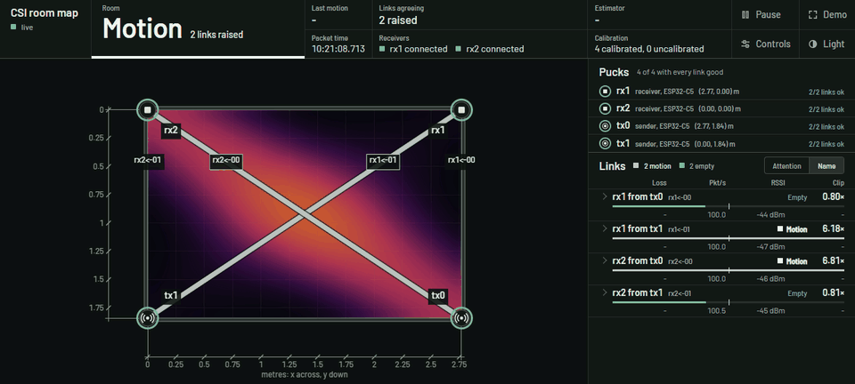
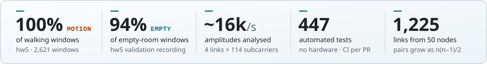
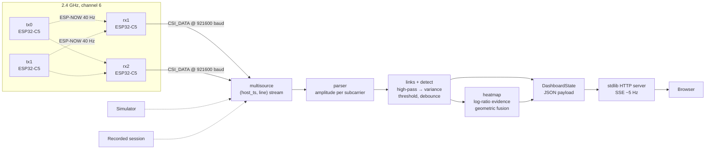

<div align="center">

<picture>
  <source media="(prefers-color-scheme: dark)" srcset="docs/assets/banner-dark.svg">
  
</picture>

Every WiFi packet arrives as a 114-subcarrier measurement of how the space scattered it on the way,
and a moving body changes that measurement. No cameras, no wearables, no line of sight.<br>
Today it runs on four boards in one room. The math doesn't care how many boards there are, or where.

[](https://github.com/CodeMetalForge-Hackathon/Team-12/actions/workflows/ci.yml)




<sub>The live dashboard (<code>--page web/ui-overhaul/index.html</code>) on the built-in simulator, real time.
As a person walks a loop through the room, the heat follows them, and each link flips between
<b>Motion</b> (thick) and <b>Empty</b> (thin) as they cross it.</sub>

<br>

<picture>
  <source media="(prefers-color-scheme: dark)" srcset="docs/assets/stats-dark.svg">
  
</picture>

[Beyond one room](#beyond-one-room) · [Quick start](#quick-start-no-hardware-needed) · [How it works](#how-it-works) · [The math](#the-math) ·
[Why it's hard](#why-this-is-hard) · [Engineering](#engineering) · [Results](#results) ·
[Docs](#documentation)

</div>

---

## The pitch

To decode a packet, every WiFi receiver already measures the channel the packet crossed: one complex gain
per subcarrier, called **Channel State Information (CSI)**. That measurement is a sensor that almost
nobody uses. When a person moves between two radios, their body blocks, reflects and bends the waves,
and the CSI changes. The person carries nothing. Smoke, darkness, drywall and foliage stop a camera, but
radio goes through them.

Our first target is firefighters and tactical teams, who need to know whether anyone is moving in a room
**before** they open the door. Fixed ESP32 boards around a room exchange
packets at 40 Hz. Each sender→receiver **link** becomes a continuous, 114-dimensional probe of the
space between them. A body moving through that space perturbs the multipath channel. We turn the
perturbation into a calibrated, debounced **EMPTY / MOTION** decision per link, and fuse the links into
a live **RF-tomography heatmap** of where in the room the change is.

| | |
|---|---|
| **Input** | Raw `CSI_DATA` from ESP32-C5 receivers, ~16,000 subcarrier amplitudes per second across four links |
| **Output** | Per-link state machine, a room-level vote, and a 28 × 18 heatmap (≈10 cm cells), streamed to the browser at ~5 Hz over Server-Sent Events |
| **Hardware** | 4 × ESP32-C5 (2 senders, 2 receivers), ESP-NOW on channel 6, vendored firmware |
| **Software** | Pure Python + NumPy signal pipeline, a standard-library HTTP/SSE server, single-file web UI |
| **Quality** | 447 automated tests, no hardware required, CI on every PR, deterministic replay |

> [!IMPORTANT]
> **Decision support, not a guarantee.** This system detects *movement*. A person who is completely
> still is not reliably detected, because the motion statistic removes the static channel by
> construction. A missed person is the costly error in search and rescue, so treat the output as one
> input to a decision, never as the only check that a room is empty. See [Limits](#limits).

## Beyond one room

The demo is one room. What we built is general: **any set of radios at known positions becomes a
motion-imaging network**. Nothing in the software assumes a room, a building or a fixed number of nodes.

- **The target carries nothing.** No tag, no phone, no cooperation needed.
- **It passes through what stops light.** 2.4 GHz radio goes through smoke, darkness, drywall, wood and
  foliage, so nodes don't need a line of sight to the target, or even to be in the same room.
- **Nodes are cheap enough to lose.** Each one is a commodity ESP32 on a battery. Every link is scored
  independently, so a lost node drops only its own links. They read NO_SIGNAL, never a false EMPTY.
- **Geometry is data.** Nodes are coordinates in [`config/room.json`](config/room.json), and they may sit
  outside the room. Adding a node is a JSON edit, not a code change.
- **Sensing grows quadratically.** Every pair of nodes is a link, so coverage grows faster than cost:

```math
L_{\text{today}} = R\cdot S
\qquad\text{vs.}\qquad
L_{\text{transceivers}} = \binom{n}{2} = \frac{n(n-1)}{2}
```

Here $R$ and $S$ count receivers and senders, and $n$ counts nodes that both send and receive. Ten such
nodes give 45 links; fifty give 1,225. Each link is one projection through the space, and the heatmap is
a backprojection of those projections. A CT scanner works the same way, with X-rays where we use radio
links: more angles give a sharper image.

| Scenario | How it would work | Already in this repo | Still to build |
|---|---|---|---|
| **Room clearing** (firefighters, tactical teams): *today's demo* | Boards at the corners of a room give per-link MOTION and a heatmap before anyone opens the door | Everything in this repo | Labelled accuracy data; detecting people who stay still |
| **Drone swarm around a building** | Drones hover outside the walls as flying nodes, and every pair of drones is a link through the building. Moving the swarm sweeps new angles through the interior, like a CT scanner's rotating gantry | Arbitrary node positions, including outside the room; independent per-link scoring; the backprojection heatmap | Node positions that move (they are static config today), radios and positioning on the drones, calibration through walls |
| **Scatter-dropped sensor field** (woods, disaster zones, search areas) | Dozens to hundreds of cheap battery nodes, dropped from the air, form a mesh. Each neighbouring pair is an invisible tripwire whose sensitive band has radius $\sqrt{\lambda d/4}$ (≈ 0.8 m for nodes 20 m apart). A person moving through the field lights a chain of links that traces their path | Links generated from config; a source interface that a radio-mesh source plugs into; CSI forwarded over ESP-NOW to a gateway (prototype on `feat/wireless-receivers`) | Nodes that locate themselves after the drop, duty-cycled power, channel scheduling at scale (TDMA: issues #16, #17, #20, #21) |
| **Camera-free buildings** (elder care, smart buildings) | Ordinary WiFi hardware doubles as a motion sensor, with no camera and nothing to wear | The full pipeline and dashboard | Reading CSI from commodity access points |

> [!NOTE]
> **Responsible use.** Sensing people who carry nothing and cannot see the sensor cuts both ways. We built
> this for rescue and safety. Consent, privacy and authorised deployment are requirements for any use
> beyond the bench.

## Quick start (no hardware needed)

> [!TIP]
> **No boards needed.** The whole pipeline runs on a built-in simulator, so you can see it working in about a minute.

```bash
python -m venv .venv && source .venv/bin/activate   # Windows: .venv\Scripts\activate
pip install -r requirements.txt && pip install -e .

python scripts/dashboard.py --simulate-room          # a simulated person walks a loop through the room
```

Open **<http://127.0.0.1:8000/>**. For the redesigned operations UI (map / 3D switch):

```bash
python scripts/dashboard.py --simulate-room --page web/ui-overhaul/index.html
```

Run the test suite (CI runs it on Ubuntu, Python 3.12):

```bash
python -m pytest -q -n auto      # 447 tests, ~1 min on a 16-thread laptop, 3-6 min on CI
scripts/check.sh                 # ruff + the fast tier, run before every commit
```

On real hardware: `python scripts/dashboard.py --auto-ports` finds the receivers by USB serial, then
calibrate with the page's **Calibrate** button or `scripts/calibrate.py`. See
[docs/operations.md](docs/operations.md).

## How it works



1. **Sense.** Senders broadcast ESP-NOW frames from MAC `1a:00:00:00:00:<id>`. Every receiver hears every
   sender, so *R* receivers and *S* senders give *R × S* links (4 today, 6 with the third receiver enabled).
   Adding a board is a JSON edit in [`config/room.json`](config/room.json), not a code change.
2. **Parse.** Each `CSI_DATA` line becomes an amplitude vector, $\lvert H_k\rvert = \sqrt{I_k^2+Q_k^2}$, over
   117 subcarriers, with the three DC nulls (57–59) masked out: 114 usable dimensions per packet.
3. **Score.** A three-stage high-pass removes the static room. What is left is the dynamic multipath, and
   its variance over a 1 s window is the link's **motion score**.
4. **Decide.** Each link compares its score against a calibrated threshold. MOTION fires on the first sample
   above it and clears only after a 0.5 s hold, because a miss is worse than a false alarm.
5. **Localise.** Each link projects its evidence onto the room along the sender–receiver segment. Overlapping
   footprints that agree are reinforced; a lone noisy link is suppressed.
6. **Serve.** One JSON frame per tick goes to the browser over Server-Sent Events. Every source (serial,
   simulator, recording, replay) is the same `(host_ts, line)` stream, so the pipeline cannot tell them apart.

## The math

The full derivation, with every constant and the function that computes it, is in
[**docs/theory.md**](docs/theory.md). The headline results:

**Channel model.** A packet on subcarrier $k$ sees a sum of propagation paths. The walls and furniture
contribute a static term; a moving body contributes a time-varying one:

```math
H(f_k,t)=\underbrace{\sum_{p\in\text{static}} a_p\,e^{-j2\pi f_k\tau_p}}_{H_s(f_k)}
\;+\;\underbrace{\sum_{p\in\text{body}} a_p(t)\,e^{-j2\pi f_k\tau_p(t)}}_{H_d(f_k,t)}
```

A body moving at speed $v$ modulates $\lvert H\rvert$ at up to $f_{\max}=2v/\lambda\approx 16$ Hz at walking
pace ($\lambda = 12.3$ cm on channel 6). Commodity radios share no clock, so carrier and sampling frequency
offsets scramble raw phase. We therefore work in **amplitude** only.

**Motion statistic.** A cascade of three first-order high-pass stages ($\tau = 0.16$ s, run on device time)
removes $H_s$ and suppresses breathing-band energy (0.1–0.5 Hz) by more than 20 dB:

```math
G(z)=\left(\frac{\beta\,(1-z^{-1})}{1-\beta z^{-1}}\right)^{3},\qquad \beta=e^{-\Delta t/\tau}
```

The score is the per-subcarrier variance of the filtered amplitude $y_k$ over a 1 s window $\mathcal W_n$,
averaged over the $K = 114$ subcarriers. Equivalently, it is the normalised trace of the window's sample
covariance:

```math
S_n=\frac{1}{K}\sum_{k\in\mathcal K}\frac{1}{\lvert\mathcal W_n\rvert}\sum_{i\in\mathcal W_n}\big(y_k[i]-\bar y_k\big)^2=\frac{1}{K}\mathrm{tr}\hat\Sigma_y(n)
```

**Robust calibration.** The room is never truly empty, so thresholds come from robust statistics. In
quiet-room mode, 1 s chunks containing movement are rejected and the threshold is a margin over the 99th
percentile. In noisy-room mode, we use a **one-sided MAD** taken from the lower half of the distribution
only, so bursts of movement during calibration cannot inflate the spread:

```math
\begin{aligned}
\theta_\ell^{\text{quiet}} &= 1.25\cdot Q_{0.99}\big(S_i : i\in\text{clean chunks}\big)\\[4pt]
\theta_\ell^{\text{noisy}} &= \max\big(m+6\cdot1.4826\,s_-,\ 3m\big),\qquad s_-=\mathrm{median}\lbrace m-x : x\le m\rbrace
\end{aligned}
```

**Spatial evidence.** For the heatmap, each link is judged against its *own* rolling 60 s median $b_\ell$ rather
than its threshold. The evidence is a clipped log-ratio that is zero up to 1.2× the baseline and saturates at 3×:

```math
e_\ell=\mathrm{clip}_{[0,1]}\!\left(\frac{\ln\big(S_\ell/(1.2\,b_\ell)\big)}{\ln 2.5}\right)
```

This is **gain-invariant**. Receiver gain $g$ scales the score as $g^2$, and the ratio cancels it exactly:
$\ln\frac{g^2 S}{g^2 b}=\ln\frac{S}{b}$.

**Geometric fusion.** Each link spreads its evidence over cells $\mathbf c$ with a Gaussian footprint around
the sender–receiver segment. $\sigma_F = 0.35$ m is on the scale of the links' first Fresnel-zone radius,
$\sqrt{\lambda d/4}$ ≈ 0.24–0.32 m. Cells blend an "any link" sum with a soft-AND geometric mean of the
two strongest contributions $p_{(1)}, p_{(2)}$, then saturate:

```math
\begin{aligned}
F_\ell(\mathbf c) &= e^{-d_\ell(\mathbf c)^2/2\sigma_F^2}\\[4pt]
\Phi(\mathbf c) &= \tfrac12\sum_\ell w_\ell\,e_\ell\,F_\ell(\mathbf c)+\tfrac12\sqrt{p_{(1)}(\mathbf c)\,p_{(2)}(\mathbf c)}\\[4pt]
T(\mathbf c) &= 1-e^{-1.3\,\Phi(\mathbf c)}
\end{aligned}
```

Each cell is then smoothed in time with exponential rise and decay ($\tau = 0.3$ s), so an empty room settles to cold.

## Why this is hard

| Problem | What we did | Where |
|---|---|---|
| No shared clock between radios: CFO and SFO make raw CSI phase meaningless | Amplitude-only features; phase discarded by design | [ADR 0007](docs/adr/0007-amplitude-only-motion-score.md) |
| Automatic gain control rescales everything, and the score goes as $g^2$ | Gain locked in firmware after 100 packets; heatmap evidence is a scale-invariant log-ratio | [theory §6](docs/theory.md#6-spatial-inference-the-heatmap) |
| The room is never empty, so you can't calibrate on silence | Chunk-rejecting p99 and a one-sided-MAD noisy-room estimator | [theory §5](docs/theory.md#5-calibration-as-robust-statistics) |
| Cheap radios differ wildly in noise floor | Measured, not guessed: S3 receivers gave 35–65% false MOTION in a quiet room against 4–16% for C5, so receivers are C5 only | [ADR 0002](docs/adr/0002-esp32-c5-receivers-only.md) |
| Uncoordinated senders collide on one channel | Measured loss: 2 senders at 100 Hz lost ~65%; at 40 Hz, ~5–10% | [ADR 0003](docs/adr/0003-one-shared-channel-at-40-hz.md) |
| Several USB receivers, each with a 32-bit counter that wraps and resets on reboot | Device time unwrapped across wraps and reboots; receivers merged in time order by a heap | [theory §9](docs/theory.md#9-time-base-and-multi-source-synchronisation) |
| A missed person can be fatal; a false alarm is cheap | Zero-latency attack and a 0.5 s release; silence reads NO_SIGNAL and a missing threshold reads UNCALIBRATED, never EMPTY | [ADR 0001](docs/adr/0001-a-miss-costs-more-than-a-false-alarm.md) |

## Engineering

The full tour is in [**docs/architecture.md**](docs/architecture.md).

- **One source seam.** Serial ports, the seeded simulator and recorded sessions all deliver the same
  `Iterable[(host_ts, line)]`, so the entire pipeline runs and is tested without hardware.
  ([ADR 0012](docs/adr/0012-host-ts-line-stream-seam.md))
- **Deterministic by design.** Detection advances on packet timestamps, never the wall clock, and receivers are
  heap-merged in time order. Replays and simulations reproduce exactly.
  ([ADR 0013](docs/adr/0013-packet-time-not-wall-clock.md))
- **Scales by configuration.** Links are the cross product of enabled receivers and enabled senders in
  `config/room.json`. Going from 4 to 6 links is a JSON edit, and a test covers it over HTTP.
- **Dependency-free web stack.** A standard-library HTTP server with Server-Sent Events and single-file offline
  pages. Control commands are loopback-only and sit behind Content-Type, Host (anti-DNS-rebinding) and Origin
  checks.
- **Never blocks on a client.** Calibration math runs off the server lock, and each browser reads a bounded frame
  log with its own cursor, so a slow client cannot stall ingest.
- **447 automated tests and more test code than product code** (6.9k vs 4.8k lines), pinned to a frozen room
  fixture so reconfiguring the live rig never changes a test outcome. Ruff and the fast tier run on every push;
  the full suite runs on every PR.
- **Reproducible hardware.** Firmware is vendored at a pinned upstream commit, and boards are found by USB serial
  rather than port name. [`scripts/flash.sh`](scripts/flash.sh) checks the chip before writing and refuses to
  reset a receiver while a dashboard is running.
- **Decisions on the record.** 18 [architecture decision records](docs/adr/README.md), each with its context,
  the alternatives considered and the measured evidence.

## Results

Measured on hardware with the current code. We report only what we measured, and say where we have no data.

| Session | Setup | Result |
|---|---|---|
| **hw5**, single link | C5 receiver, S3 sender, ~2 m, ch 6, gain locked | **Walking: 100% MOTION** (2,621 windows). **Empty: 94% EMPTY** at margin 1.25, 95% at 1.5. |
| hw3, single link | Same boards, before the gain lock | Walking: 80% MOTION, against 100% on hw5 once the gain was locked. |
| Receiver chip study | Quiet room, same rig | False MOTION: **4–16% on C5** vs 35–65% on S3. This drove the C5-only decision. |
| **Four-link rig** | 2 × C5 receivers, 2 senders, ch 6, 40 Hz | All four links at 36–38 packets/s (measured when `tx0` was still an S3), ~5% loss. Quiet scores ~2–7 against thresholds ~8–20. A continuous walk reliably lights the left-wall and diagonal links and the heatmap. |
| Breathing (experimental) | hw5, `--breathing` | 43% of empty windows read STILL_PRESENT, so it ships **off by default**. |

There is no labelled recording of the four-link rig yet, so we quote no accuracy figure for it. Building one is
the first item on the roadmap below.

## The rig

```
   x = 0 m                                         x = 2.77 m
  +--------------------------------------------------------+  y = 0
  | rx2  ESP32-C5 receiver          rx1  ESP32-C5 receiver |
  |                                                        |
  |       4 links: rx2<-00  rx2<-01  rx1<-00  rx1<-01      |
  |                                                        |
  | tx1  ESP32-C5 sender              tx0  ESP32-C5 sender |
  +--------------------------------------------------------+  y = 1.84
```

A 2.77 m × 1.84 m room with receivers on USB and senders on battery or USB. A third receiver (`rx3`, top
middle) is defined and disabled in [`config/room.json`](config/room.json). Wiring, flashing and scaling
are in [docs/hardware.md](docs/hardware.md).

## Limits

We would rather you hear these from us:

- **Motion, not presence.** The high-pass that rejects the static room also rejects a still person. The
  heatmap's rolling baseline absorbs someone who stays in one place for about 30 s.
- **One mover, zone-level.** The heatmap shows *where change is*, not where a person is. It does not count or
  separate people.
- **Bench prototype.** One 2.77 × 1.84 m room, four wired boards, one moving person.
- **Thresholds go stale on a receiver reset**, because the gain baseline moves. Recalibrate after one.
- **Shared channel.** More senders mean more collisions; with three senders, drop to ~30 Hz.
- **Local demo security.** There is no authentication. Commands are loopback-only by default.

## Roadmap

**In flight on feature branches** (not yet merged to `main`):

| Branch | What it adds |
|---|---|
| `feat/kalman-tracker` | A Kalman filter that tracks the heatmap's hot blob over time, plus `rx3` enabled for 6 links |
| `feat/wireless-receivers` | Receivers forward CSI over ESP-NOW to one Raspberry Pi gateway, plus a guided accuracy protocol (spoken prompts, raw CSI recording, replay scoring) |
| `UI-Overhaul` | An operations view with the room in 3D on the building floor plan |
| `fix/scaling-and-accuracy` | An offline accuracy tuner that replays logged walks under other heatmap and tracker settings, plus room-footprint masking |
| `siv/turn-taking` | Senders take turns on the shared channel, to cut collisions |

**Next:**

- A labelled four-link dataset, and a small classifier compared with the threshold detector on held-out sessions.
- Detecting still people (a breathing band with a usable noise floor).
- Adaptive detection (`--auto-threshold`) as the default, once its walking sensitivity matches the fixed thresholds.
- Floor-plan rooms instead of rectangles.

## Documentation

| Doc | What's in it |
|---|---|
| [docs/theory.md](docs/theory.md) | Signal model and detection math: every equation, constant and source function |
| [docs/architecture.md](docs/architecture.md) | System diagram, module map, concurrency, HTTP API, testing strategy |
| [docs/adr/](docs/adr/README.md) | Architecture decision records, with evidence |
| [GLOSSARY.md](GLOSSARY.md) | Domain vocabulary: link, score, threshold, gain baseline and more |
| [docs/hardware.md](docs/hardware.md) | The rig, flashing with `scripts/flash.sh`, scaling up, finding ports |
| [docs/operations.md](docs/operations.md) | Calibrating, running live, recording, evaluating, troubleshooting, every CLI flag |
| [firmware/README.md](firmware/README.md) | The vendored ESP32 firmware and our edits to it |
| [docs/agents/](docs/agents/project-context.md) | Working notes for contributors and coding agents |

## Contributing

Work lands on `main` through pull requests from `csi-sensing`. Use a git worktree per branch, and run
`scripts/check.sh` before committing (`--full` before a merge). The process is in
[docs/agents/implementer-brief.md](docs/agents/implementer-brief.md). Thirty-three tests drive bash or POSIX
signals, so run the full suite on Linux or macOS. CI covers it on every PR.

## License

[Apache 2.0](LICENSE). Firmware derived from Espressif's [esp-csi](https://github.com/espressif/esp-csi).
