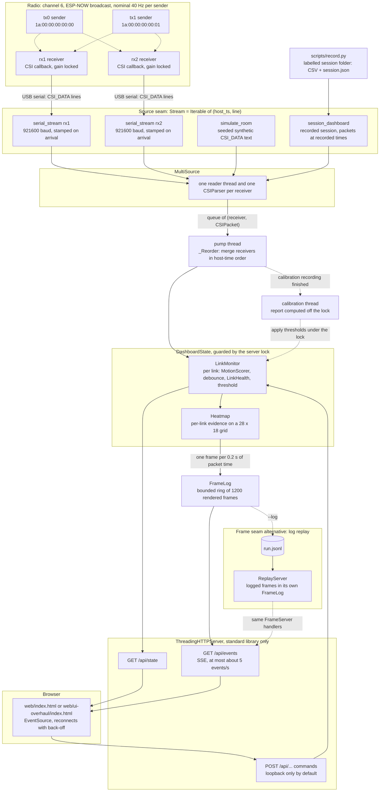

# Architecture and engineering

Team 12 senses motion in a room without anything worn or carried by the person. It uses WiFi channel state
information (CSI) measured by ESP32 boards. Sender boards broadcast ESP-NOW packets. Each receiver measures the
channel on every packet and prints one `CSI_DATA` line per packet over USB serial. The `csi/` Python package turns
those lines into a motion score per sender-to-receiver **link**, a room heatmap and a live dashboard.

This page is for reviewers. It covers how the system is built and why, with each claim tied to the code. For
usage, calibration and measured results, see the [README](../README.md). The scope is a bench prototype: a
2.77 m x 1.84 m room, four ESP32-C5 boards, one moving person and zone-level accuracy.

**At a glance**

| | |
|---|---|
| Pipeline | ESP32 senders → ESP32 receivers → USB serial → `csi/` package → standard-library HTTP + Server-Sent Events (SSE) → a single static HTML page |
| Core abstraction | Every packet source is a `Stream = Iterable[tuple[float, str]]` of `(host_ts, line)`, so serial, simulated and recorded data use the same pipeline |
| Time model | State advances on timestamps carried by the packets, not on wall-clock time, so replays and seeded simulations are reproducible |
| Scaling | The links are every enabled receiver paired with every enabled sender in `config/room.json`. Adding a board is a configuration change, not a code change |
| Web stack | `http.server.ThreadingHTTPServer` with no web framework. The pages are single files with no network assets and no build step |
| Quality | 447 tests across 50 modules, with more lines of tests (6,919) than of `csi/` (4,803). Ruff and the fast tier run before every push; CI runs ruff and the full suite on every pull request |

Contents: [1. System diagram](#1-system-diagram) · [2. Module map](#2-module-map) ·
[3. Design principles](#3-design-principles) · [4. Concurrency model](#4-concurrency-model) ·
[5. HTTP API](#5-http-api) · [6. Testing and quality](#6-testing-and-quality) ·
[7. Repository layout](#7-repository-layout) · [8. Hardware and firmware interface](#8-hardware-and-firmware-interface) ·
[Known limits](#known-limits)

---

## 1. System diagram



The diagram has two seams.

- **The source seam** (`csi/parser.py`, `Stream`). Real receivers (`serial_stream`), the seeded simulator
  (`simulate_room`, `looping_room_streams`) and recorded sessions (`csi/replay.py`, `session_dashboard`) all
  deliver `(host_ts, line)` pairs to `MultiSource`. The simulator writes real `CSI_DATA` text, so the production
  parser runs on every simulated packet. A recorded session's packets are already parsed: it puts a `CSIPacket` where
  the line would go, and `MultiSource` passes it straight through. The roadmap's wireless (UDP) receiver would be one
  more generator here.
- **The frame seam** (`csi/server.py`, `FrameServer`). `DashboardServer` renders frames from the live pipeline.
  `ReplayServer` serves the frames that a `--log` run wrote, unchanged. Both sit behind the same `/api/state`,
  `/api/events` and `/` handlers, so the browser cannot tell a replay from a live run, except that a replay
  refuses commands.

---

## 2. Module map

`csi/` holds 25 modules plus an empty `__init__.py`. Each responsibility below comes from the module's docstring.

| Layer | Module | Responsibility | Key public types and functions |
|---|---|---|---|
| Ingest | [`parser.py`](../csi/parser.py) | Parses `CSI_DATA` serial lines into per-packet amplitude vectors. Infers the column layout of each chip and masks null subcarriers. Never raises on bad input; counts it instead | `Stream`, `CSIPacket`, `CSIParser` (`feed`, `parse_line`, `stats`), `ParserStats`, `parse_stream`, `serial_stream`, `DEFAULT_HEADER`, `C5_HEADER` |
| Ingest | [`multisource.py`](../csi/multisource.py) | Reads several receivers at once into one queue of `(receiver, CSIPacket)`, one thread and parser per receiver. Round broadcasts in the queue are bounded: a live one that finds it full is dropped and counted, a recorded one waits | `MultiSource` (`start`, `drain`, `status`, `errors`, `finished`, `close`, `take_dropped`, `queued_broadcasts`), `parse_port_specs` |
| Ingest | [`ports.py`](../csi/ports.py) | Finds each board by its USB serial (its base MAC address), not by its port name. Never opens a port | `resolve_receiver_ports`, `match_ports`, `PortReport`, `PortResolutionError`, `normalise_serial` |
| Ingest | [`gateway.py`](../csi/gateway.py) | Wireless receivers: splits the gateway board's one serial stream back into one stream per receiver, named by its serial in `config/room.json` | `split_gateway`, `gateway_streams` |
| Signal | [`clock.py`](../csi/clock.py) | Turns the ESP32's 32-bit microsecond counter into time that always moves forward, and classifies each backward jump as a counter wrap or a receiver reboot | `DeviceClock.advance` → `(t_us, event)`, events `NORMAL`, `WRAP`, `RESET` |
| Signal | [`health.py`](../csi/health.py) | Per-link packet rate and drops, inferred from gaps in device time | `LinkHealth` (`observe`, `rate_hz`, `packet_rate`, `drops`, `reboots`, `wraps`) |
| Signal | [`detect.py`](../csi/detect.py) | Motion score (cascaded high-pass filter, variance over 1 s of device time), debounced detector, empty-room calibration | `MotionScorer`, `detect`, `detect_packets`, `calibrate`, `calibrate_clips`, `Calibration`, `CalibrationError`, `classify`, `validate_margin` |
| Signal | [`adaptive.py`](../csi/adaptive.py) | Experimental `--auto-threshold` mode: each link learns its own noise baseline, and the room state needs links to agree | `AdaptiveDetector`, `RoomDecision`, `replay_series` |
| Signal | [`breathing.py`](../csi/breathing.py) | Experimental breathing rate from a 15 s window (0.1 to 0.5 Hz band, principal component analysis, FFT peak). Off by default | `estimate_breathing` → `BreathingEstimate` |
| Model | [`room.py`](../csi/room.py) | Room geometry from the configuration file. The links are every receiver paired with every sender. Also models a simulated person's position | `load_room`, `Room` (`links()`, `wall_point`), `Node`, `Walk`, `Stand`, `link_responses`, `DEFAULT_ROOM_PATH` |
| Model | [`links.py`](../csi/links.py) | Splits tagged packets out by link, one detector per link, and calibrates several links at once | `LinkId`, `LinkMonitor`, `calibrate_links`, `calibrate_links_report`, `LinkCalibration`, `save_thresholds`, `load_thresholds` |
| Model | [`heatmap.py`](../csi/heatmap.py) | Heatmap of where motion is likely, in the style of RF tomography. Each link's evidence is measured against its own quiet baseline and spread along the line between its two boards | `Heatmap` (`advance`, `set_params`, `values`, `contributing`), `link_evidence`, `QuietBaseline`, `segment_falloff` |
| Model | [`rti.py`](../csi/rti.py) | Radio tomography for rooms with transceivers: elliptical link weights and the regularised projection that images every link's evidence at once, cached per layout ([ADR-0024](adr/0024-radio-tomography-heatmap.md)) | `RtiImager` (`image`), `imager`, `ellipse_weights`, `projection` |
| Model | [`tracker.py`](../csi/tracker.py) | The motion track: a Kalman filter following the heatmap's hot blob | `Tracker`, `heat_measurement` |
| Model | [`dashboard.py`](../csi/dashboard.py) | Builds the single JSON payload the page renders from | `DashboardState` (`push`, `snapshot`, `set_threshold`, `set_params`, `parameters`) |
| Serving | [`server.py`](../csi/server.py) | HTTP server: frame log, SSE stream, guarded commands, and the reordering pump | `FrameServer`, `DashboardServer`, `FrameLog`, `controls_allowed`, `is_loopback`, `simulated_thresholds`, `looping_room_streams` |
| Serving | [`live_calibration.py`](../csi/live_calibration.py) | Calibration inside the dashboard, run on the live stream: countdown, recording, processing, then done or failed | `CalibrationJob`, `parse_request`, `RequestError` |
| Serving | [`replay.py`](../csi/replay.py) | Serves a logged run, or a recorded session, through the dashboard's HTTP interface | `load_log`, `ReplayLog`, `ReplayServer`, `session_dashboard`, `ReplayError` |
| Offline | [`noisy_calibration.py`](../csi/noisy_calibration.py) | Thresholds for a room that is never empty: a pure, standard-library function of each link's live scores | `noisy_room_thresholds`, `link_threshold`, `LinkThreshold` |
| Offline | [`recording.py`](../csi/recording.py) | Writes labelled session folders (one CSV per label, plus `session.json`) and loads them back | `record_session`, `RecordingReport`, `load_session`, `load_recording`, `Session`, `Recording`, `LABELS` |
| Offline | [`evaluate.py`](../csi/evaluate.py) | Evaluates the live detectors offline on recorded sessions, with a confusion matrix per label. Splits by recording, never by random window | `evaluate_sessions`, `format_report`, `EvaluationReport`, `SessionResult` |
| Offline | [`simulate.py`](../csi/simulate.py) | Seeded fake CSI for development without hardware, written as real `CSI_DATA` text | `simulate_room`, `simulate_room_links`, `simulate_link_streams`, `simulate_stream`, `packet_to_line`, `Segment` |
| Tools | [`common.py`](../csi/common.py) | Command-line plumbing shared by the single-port tools (`--simulate`, `--port`, `--rate`, `--margin`, thresholds) | `add_source_args`, `add_threshold_args`, `resolve_threshold`, `open_source`, `SenderWatch` |
| Tools | [`viewer.py`](../csi/viewer.py) | Rolling buffers for the matplotlib viewer: data only, no plotting | `LiveView` |
| Tools | [`rawlog.py`](../csi/rawlog.py) | Raw CSI recording: every line a receiver delivers, with its host time, for exact offline replays | `tee_sources`, `read_raw` |
| Tools | [`accuracy.py`](../csi/accuracy.py) | The guided accuracy run: marks, the protocol, and ground truth from its prompts | `Segment`, `segments_from_labels`, `twin` |

**Entry points** (`scripts/`):

| Script | What it does |
|---|---|
| [`dashboard.py`](../scripts/dashboard.py) | The dashboard server. Sources: `--port`, `--auto-ports`, `--simulate-room`, `--replay run.jsonl` or `--replay-session DIR`. Also takes `--log`, `--page`, `--allow-control` and `--auto-threshold` |
| [`links_live.py`](../scripts/links_live.py) | A terminal table with one row per link. `--calibrate` writes `links.json` |
| [`calibrate.py`](../scripts/calibrate.py) | Noisy-room thresholds from a running dashboard, sampled over HTTP. `--apply` sets them and saves them |
| [`detect_live.py`](../scripts/detect_live.py), [`telemetry.py`](../scripts/telemetry.py), [`live.py`](../scripts/live.py) | Single-port tools: debounced state, a one-line status, and a matplotlib viewer |
| [`record.py`](../scripts/record.py), [`evaluate.py`](../scripts/evaluate.py) | The labelled recorder (switch labels with keys) and the offline evaluator |
| [`ports.py`](../scripts/ports.py) | Lists connected boards matched to room nodes by USB serial. Opens no port |
| [`flash.sh`](../scripts/flash.sh) | Builds one board, checks that the port holds the named chip, then flashes it. Has `--dry-run`, and refuses to flash a receiver while a dashboard answers |
| [`check.sh`](../scripts/check.sh) | Runs `ruff check .`, then the fast test tier in parallel. `--full` runs the whole suite |

Third-party imports are few. The code imports `numpy` (signal processing), `pandas` (recording and evaluation
only), `pyserial` (only where a real port is listed or opened, so simulated runs never touch it) and `matplotlib`
(only `scripts/live.py`). The HTTP server and the pages add no dependencies.

---

## 3. Design principles

### 3.1 One source seam: `(host_ts, line)`

`Stream = Iterable[tuple[float, str]]` ([`csi/parser.py`](../csi/parser.py)) is the only contract between packet
sources and the pipeline. In ports-and-adapters terms, it is the port, and each source is an adapter:

| Adapter | Where | What it yields |
|---|---|---|
| Real receiver | `parser.serial_stream` | `(time.time(), line)` for each line read. A read timeout yields `(t, None)`, a heartbeat that lets the reader thread check its stop flag at least once a second |
| Simulated room | `simulate.simulate_room`, `server.looping_room_streams` | Synthetic `CSI_DATA` text, one stream per receiver, carrying every sender's packets |
| Recorded session | `replay.session_dashboard` | Recorded packets at their recorded host times, divided by `--speed` |

`DashboardServer(room, sources, thresholds)` takes `sources` as a plain `{receiver name: Stream}`. Nothing after
`MultiSource` knows where a packet came from. The same seam serves `record_session`, `detect`, `LinkHealth.consume`
and `LiveView`.

### 3.2 Packet time, not wall-clock time

Two clocks are used, and each has one job.

- **Device time** is the receiver's `local_timestamp`, a 32-bit microsecond counter that wraps about every
  71.6 minutes. `DeviceClock` ([`clock.py`](../csi/clock.py)) unwraps it. It reads a backward jump as a counter wrap
  when the elapsed host time agrees, and as a reboot otherwise. Device time drives the signal processing: the 1 s
  variance window, the high-pass filter and drop counting. A dropped packet therefore never stretches a window, and
  a reboot restarts the state that was built on the old timeline.
- **Host time** is each packet's `host_ts`. It drives the merge across receivers, link states, the heatmap's
  smoothing and frame emission. The heatmap's docstring says "All time is host time from the packets, never the
  wall clock", and `adaptive.py` makes the same rule for its detector.

`_Reorder` in [`server.py`](../csi/server.py) holds packets in a heap and releases them in host-time order, once
every active receiver has reached that time. Its docstring says this is "so the state does not depend on thread
timing". `DashboardServer._clock()` lets the clock run ahead of the packets only for live sources stamped with the
wall clock, so that a silent link turns NO_SIGNAL. Replays and simulations advance only with their packets. The
simulators are seeded per link (`np.random.SeedSequence([seed, receiver_index, sender_index])`). The result is
deterministic replay. A logged run is served exactly as it was written. A recorded session or a seeded simulation
is processed on its own timestamps, so its results follow from the data rather than from when the threads ran. The
tests rely on this, for example `test_evaluation_is_deterministic` and the replay tests that check the track of the
hottest heatmap cell.

### 3.3 Configuration as data

[`config/room.json`](../config/room.json) holds the room's size, its nodes (role, chip, position, sender `mac`, USB
`serial`, `enabled`) and optional `link_weights`. The code derives everything else from it.

- `Room.links()` is `[(rx, tx) for rx in receivers for tx in senders]`. Two receivers and two senders give 4 links.
  Enabling the defined `rx3` gives 6 links with no code change. The simulator, `LinkMonitor`'s expected links, the
  heatmap footprints, the payload and the page are all built from the `Room`.
- A node with `"enabled": false` is left out of the room. It has no links, and its stream is never read:
  `DashboardServer` filters out `room.disabled`.
- The `CSI_ROOM` environment variable overrides the configuration path. The tests use it (see 6).
- Covered over HTTP by `test_dashboard_payload_lists_six_links_and_three_receiver_nodes_over_http`.

### 3.4 A small, locked-down web stack

- **No framework.** The server is `http.server.ThreadingHTTPServer` plus `json` and `threading`. Each page is one
  static HTML file with no network assets and no build step. `web/ui-overhaul/index.html` inlines its 3D library
  and fonts.
- **Loopback by default.** The server binds `127.0.0.1:8000`. The five command endpoints work only on a loopback
  bind, or with an explicit `--allow-control` (`controls_allowed`).
- **Request checks before any command runs** (`FrameServer.refusal`):
  - The `Content-Type` must be exactly `application/json`, or the server answers 415. A cross-site form cannot send
    that media type without a preflight request, and the server never grants one.
  - The `Host` header must name this server and its bound port, or the server answers 403. This blocks DNS
    rebinding.
  - An `Origin` header, when present, must be an `http` origin of this server, or the server answers 403.
- **Body limits.** A body may be at most 64 KiB (413) and must be a JSON object (400). Unknown fields and
  out-of-range values get 400.
- **Replays are read-only.** Commands return 409. Section 5 has the full table, and `test_dashboard_guard.py`
  covers these checks over HTTP.

### 3.5 Slow work stays off the server lock

A calibration records its clips under the server lock, which costs only appends. Computing the report
(`calibrate_links_report`) is the slow step, so `DashboardServer._defer_calibration` runs it on a
`dashboard-calibration` thread without the lock. The thread takes the lock again only to apply the new thresholds.
Meanwhile the job is in state `processing` and takes no packets, so the clips the report reads cannot change. Frames,
`/api/state` and commands keep flowing. When a run ends, `_finish_run` waits for the calibration thread, without
holding the lock and for at most 30 s, so that the final frame shows the result.

### 3.6 Boards are identified by USB serial, not by port name

Port names such as `/dev/cu.usbmodem*` change on every replug. A board's USB serial is its base MAC address and
does not change. Each node in `config/room.json` can carry its `serial`. [`csi/ports.py`](../csi/ports.py) matches
the output of `list_ports.comports()` against those serials, ignoring case and separators. `--auto-ports` resolves
every enabled receiver or fails, naming each problem: no serial in the configuration, board not connected, or a
serial that matches more than one port. Matching is a pure function of the port listing and never opens a port.
That matters because opening a port can reset a board on native USB, which resets its gain baseline (see 8). The
tests pass fake port listings.

### 3.7 Firmware is vendored for reproducibility

`firmware/csi_recv` and `firmware/csi_send` are Espressif's `esp-csi` getting-started examples at upstream commit
`8633d67`, with our edits, built with ESP-IDF 5.5.6. `sdkconfig.defaults` and `dependencies.lock` are committed, and
build output is gitignored. [`scripts/flash.sh`](../scripts/flash.sh) gives each chip and role its own build directory
(`build_<chip>`, or `build_<chip>_id<NN>` for a sender). It reads the chip on the port before writing, and it refuses
to flash a receiver while a dashboard answers on port 8000, unless given `--force`. `--dry-run` prints every command
and runs none. Its tests run against fake `idf.py` and `python` shims and an ephemeral fake dashboard.

### 3.8 A missed person costs more than a false alarm

The intended users are firefighters and similar teams who need to know whether someone is in an area. A missed
person is the costly error, so the code chooses the safe side wherever the two kinds of error trade off.

- **Motion is raised at once and cleared slowly.** In `_Debouncer` ([`detect.py`](../csi/detect.py)), MOTION takes
  effect on the first window above the threshold. Leaving MOTION requires the quieter state to persist for 0.5 s
  (`DEBOUNCE_S`). The room summary (`RoomDecision`, reported as `status.room`) uses the same debouncer, with a 1 s
  hold.
- **Silence never reads as EMPTY.** A link with no packet for 2 s reads `NO_SIGNAL`. A link without a threshold
  reads `UNCALIBRATED` and is still scored. The terminal tools refuse a real port that has no explicit threshold
  rather than guess one (`common.resolve_threshold`).
- **Calibration protects sensitivity.** Quiet-room calibration judges the clip in 1 s chunks. It drops a chunk whose
  median is more than 3 times the quiet baseline, or whose 90th percentile is more than 2.5 times its own median.
  This keeps a passer-by from raising the threshold, which would make later motion easier to miss. Noisy-room mode
  keeps every chunk and reports how much of the clip looked like movement.
- **Failure is visible.** If processing a packet raises, the run ends with a final frame that names the receiver
  and the error. The code calls this the alternative to "a stale picture that looks live". The page stops
  reconnecting once a run has finished.

### 3.9 Faults stay contained

- `CSIParser` never raises on input. `ParserStats` counts malformed, ignored and layout-skipped lines, and layout
  re-locks.
- A source that raises is marked failed in `status.receivers` and `status.errors`, and the other receivers keep
  running.
- A command handler that raises returns a 500 with the error message. The comment there reads "a bad request must
  never kill the handler thread".
- A client that disconnects in the middle of a stream is treated as normal and leaves no thread behind
  (`test_client_disconnecting_mid_stream_leaves_no_thread_and_no_traceback`).

---

## 4. Concurrency model

| Thread | How many | Work | Synchronisation |
|---|---|---|---|
| `csi-read-<receiver>` | One per enabled receiver | Iterates its source and parses each line with its own `CSIParser`, so one receiver's layout warm-up or bad lines never affect another. Puts `(receiver, CSIPacket)` on the queue | `queue.Queue` for packets. `MultiSource._lock` for status and errors |
| `dashboard-pump` | 1 | Drains the queue (waiting up to 50 ms), reorders packets in `_Reorder`, feeds `DashboardState` and any running `CalibrationJob`, and emits frames | Takes the server lock once per batch |
| `dashboard-http` | 1 | `serve_forever` (polls every 0.1 s) | None |
| Request handlers | One per connection (`daemon_threads`) | `/api/state` renders a fresh payload. `/api/events` streams frames. POST requests run commands | The server lock for state and commands. `FrameLog`'s condition variable for SSE |
| `dashboard-calibration` | 0 or 1 | Computes a finished calibration's report | Runs without the lock. Takes it only to apply the result |
| `dashboard-replay` | 1, in log replay only | Appends the logged payloads at the logged pace, divided by `--speed` | The server lock and `FrameLog` |

**Locks.** `FrameServer._lock` is one coarse lock over all mutable dashboard state: `DashboardState`, the calibration
job, thresholds and the command log. The pump is the only thread that writes packets into that state. Commands are
short and run under the same lock. `FrameLog` has its own `threading.Condition`. Locks are always taken in the same
order: `_emit` appends to the log while holding the server lock, and an SSE handler never holds the condition while
it takes the server lock. No cycle is possible.

**How a frame reaches the browser**

1. A reader thread parses a line and puts `(receiver, CSIPacket)` on the queue. The queue is unbounded, so a reader
   never blocks on the pipeline.
2. The pump drains everything available and adds it to the `_Reorder` heap. It releases packets up to a high-water
   mark: the oldest of the newest timestamps among active receivers. A receiver that has been silent for 1 s of wall
   time stops holding the others back. At start-up, a connected receiver that has not sent anything yet is waited
   for, for up to 2 s.
3. Under the lock, `DashboardState.push` updates the link's monitor and the heatmap. After every 0.2 s of packet
   time, `_emit` writes one JSON payload into `FrameLog`. With `--log`, it also appends the payload to the log file
   and flushes it.
4. With no packets arriving, `_idle_frame` keeps live frames coming on the clock, so silent links turn NO_SIGNAL. It
   also advances the calibration countdown.
5. Each SSE handler keeps its own cursor and blocks on the condition variable in `FrameLog.next_frame`. It sends at
   most one event per 0.2 s of wall time. After 15 s without an event it sends a `: keepalive` comment, so that a
   dead client raises an error on write and its handler ends.
6. **Slow consumers are decoupled, not back-pressured.** The pipeline never waits for a client. The log keeps 1200
   frames, 4 minutes at 5 Hz. A live client that falls more than 5 frames behind jumps to the newest frame. A client
   that connects after the run has finished is sent the retained run from its oldest frame up to the final one.
7. The page's `EventSource` reconnects with exponential back-off from 0.5 s to 8 s. It stops for good once a payload
   says `status.finished`.

**Shutdown.** `FrameServer.stop()` is idempotent. It sets the stop event, shuts down the HTTP server and closes the
sources. `MultiSource.close()` sets the readers' stop flag and joins each reader. Each reader closes its own port in
a `finally` block on its own thread, and the 1 s serial heartbeat means a silent port still notices the stop flag.
`stop()` then joins every thread, with a time limit. `scripts/dashboard.py` maps SIGTERM to the Ctrl+C path, so both
release every port.

---

## 5. HTTP API

The default address is `127.0.0.1:8000` (`--host`, `--http-port`). Page and JSON responses set
`Cache-Control: no-store`, and the event stream sets `no-cache`. This table comes from
[`csi/server.py`](../csi/server.py). The status codes for the request checks were confirmed against a running
server.

| Method and path | Purpose | Restrictions |
|---|---|---|
| `GET /` and `GET /index.html` | The page: `web/index.html`, or the file given with `--page` | None |
| `GET /api/state` | One payload: `room`, `nodes`, `links`, `heatmap`, `status` | None |
| `GET /api/events` | The same payloads as SSE (`data: <json>`), at most about 5 per second, with a keepalive comment after 15 s idle. The last event has `status.finished: true`, then the stream closes | None |
| `GET /api/thresholds` | `{thresholds, path}`: current fixed thresholds and the file they save to | Live server only. 404 in replays |
| `POST /api/calibrate` | Starts a calibration. `{clips 1–10, seconds 1–120, margin > 0, lead_s 0–60, noisy}`, defaults 3, 10, 1.25, 5, true. Returns 202 | Command checks below. 409 if one is already running |
| `POST /api/calibrate/cancel` | Cancels a calibration during its countdown or recording. Thresholds stay unchanged | Command checks. 409 if none is running |
| `POST /api/threshold` | `{link, value}` sets one link's threshold. `value: null` returns the link to auto mode, or to UNCALIBRATED in fixed mode | Command checks. 400 for an unknown link or a value that is not positive |
| `POST /api/thresholds/save` | Writes `{label: threshold}` to `--save-thresholds`, else to the `--thresholds` file, else to `links_thresholds.json` in the working directory | Command checks. 409 if there is nothing to save |
| `POST /api/params` | Changes the live heatmap settings: `sensitivity` 0.01–10, `decay` 0.05–60 s, `rise` 0.01–10 s, `falloff` 0.05–2 m (not on a transceiver room: its heatmap is radio tomography) | Command checks. 400 for an unknown key, a value out of range, or `falloff` on a transceiver room |

Command checks, in the order the server applies them:

1. A path that is not a command gets 404.
2. A `Content-Type` other than `application/json` gets 415.
3. A `Host` or `Origin` that is not this server gets 403.
4. A body over 64 KiB gets 413.
5. A body that is not a JSON object gets 400.
6. Controls that are off gets 403: the bind is not loopback and `--allow-control` was not given.
7. A replay gets 409.
8. The handler runs, and may return its own 400, 409 or 500.

Any other path gets 404.

**Payload.** The schema is in the docstring of [`csi/dashboard.py`](../csi/dashboard.py), and `server.py` adds the
`status` extension. Each link row carries `id`, `receiver`, `sender`, `mac`, `state`, `mode`, `elevated`, `level`,
`score`, `threshold`, `normalised`, `baseline`, `evidence`, `pkt_rate`, `drops`, `rssi`, `age_s`, `weight` and
`contributes`. `status` carries `time_s`, `links_by_state`, `parameters`, `room`, `receivers`, `errors`, `finished`,
`calibrated_links`, `adaptive_links`, `uncalibrated_links`, `messages`, `calibration` and `commands`.

**Files the system writes:**

| File | Format |
|---|---|
| `links.json` | A flat JSON object of `{"rx1<-00": threshold, ...}` |
| `run.jsonl` (`--log`) | A header line (`format: "csi-dashboard-log"`, `version: 1`, room, thresholds, mode, heatmap parameters, source), then one payload per line, exactly as sent over SSE. `load_log` refuses any other file and reports the number of a corrupt line |
| Session folder | `session.json` plus one `<label>_<UTC timestamp>.csv` per recording. Columns: `host_ts, device_ts, rssi, channel, mac, amp_0 … amp_N` |

---

## 6. Testing and quality

**Numbers.** These come from `python -m pytest --collect-only -q`.

- **447 tests in 50 modules.** 69 are marked `slow`, so the fast tier has 378.
- **6,919 lines of tests**, against 4,803 lines in `csi/`.
- **Run times.** With `-n auto` on a 16-thread machine, the full suite takes 47 s and the fast tier about 22 s. On
  GitHub Actions the full suite is about four times slower: its test step took 193.8 s (3 m 14 s) for PR #26
  ([run 42471421015](https://github.com/CodeMetalForge-Hackathon/Team-12/actions/runs/42471421015)).
- **CI** runs the full suite on Ubuntu with Python 3.12.
- **The suite assumes a POSIX system.** 33 tests drive bash scripts, POSIX signals or a pseudo-terminal, so run it on
  Linux or macOS, as CI does.

**Strategy**

- **No hardware in any test.** The simulators are the test doubles. They are seeded, and they write real `CSI_DATA`
  text, so tests exercise the production parser and every later stage. Where hardware would be touched, the tests
  use fakes:
  - a fake `pyserial` port that never sends anything (`test_serial_stream.py`)
  - fake `list_ports` results (`test_ports.py`)
  - fake `idf.py` and `python` executables on the `PATH`, plus a fake dashboard on a random local port
    (`test_flash_script.py`)
- **Tests assert at the seams.** Module docstrings name each test's seam. Some tests assert only on the HTTP
  interface ("every assertion is on a response"). Others assert at the text seam (simulator → text → parser) or on
  the `DashboardState.snapshot` payload. The dashboard page's geometry is checked by running the page's own script
  under Node with a small stand-in for the browser DOM. Those tests are skipped when Node is not installed.
- **A frozen room fixture.** [`tests/conftest.py`](../tests/conftest.py) sets `CSI_ROOM` to
  `tests/fixtures/room_rig4.json` before any test imports `csi`, so reconfiguring the live rig never changes a
  test's outcome. `test_guards.py` fails if that pin is lost, or if any test file except the deliberate one
  (`test_config_driven_nodes.py`) refers to `config/room.json`. More layouts live in `tests/fixtures/`:
  `room_5node.json` and `room_star.json`, which places a receiver outside the room.
- **SSE pacing is off in tests.** An autouse fixture turns off the SSE stream's wall-clock pacing, so tests read
  events at full speed. The pacing test opts back in with `@pytest.mark.real_sse_pacing`.
- **The Markdown is linted too.** [`tests/test_docs.py`](../tests/test_docs.py), in the fast tier, checks that math
  is GitHub-safe and that relative links and their `#anchors` resolve.
- **Edge cases are pinned down.** The tests cover:
  - 32-bit counter wraps and receiver reboots (`test_detect.py`, `test_health.py`)
  - out-of-order packets (`test_out_of_order.py`)
  - reboot-free continuity across simulator loop boundaries (`test_looping_stream.py`)
  - a pipeline exception ending in a final frame (`test_dashboard_pipeline.py`)
  - DNS rebinding and cross-site requests (`test_dashboard_guard.py`)
  - corrupt replay logs, reported by line number (`test_dashboard_replay.py`)

**Tooling**

| Gate | What runs | When |
|---|---|---|
| [`scripts/check.sh`](../scripts/check.sh) | `ruff check .`, then `pytest -q -n auto -m "not slow"`. `--full` runs the whole suite | Before a commit. `--full` before a merge |
| [`.githooks/pre-push`](../.githooks/pre-push) | `scripts/check.sh`. Bypass with `SKIP_CHECK=1` | Every `git push`, once enabled with `git config core.hooksPath .githooks` |
| [`.github/workflows/ci.yml`](../.github/workflows/ci.yml) | `ruff check .`, then `python -m pytest -q -n auto` (the full suite), on `ubuntu-latest` with Python 3.12, a pip cache and a 15-minute timeout | Every pull request and every push to `main`. A new push cancels the run it replaces (`concurrency` with `cancel-in-progress`) |
| Ruff ([`pyproject.toml`](../pyproject.toml)) | Pyflakes (`F`) and syntax errors (`E9`), line length 120. Style rules are left out on purpose, with the reason recorded in `pyproject.toml` | In `check.sh` (and so in the pre-push hook) and in CI |

Run the checks yourself:

```bash
pip install -r requirements.txt && pip install -e .
scripts/check.sh            # ruff + fast tier
scripts/check.sh --full     # ruff + all 447 tests
```

---

## 7. Repository layout

```
.
├── .github/workflows/ci.yml   CI: ruff + full test suite on each pull request and push to main; superseded runs cancelled
├── .githooks/pre-push         runs scripts/check.sh before a push (opt in: git config core.hooksPath .githooks)
├── config/
│   ├── room.json              the live rig: room size, nodes (role, chip, x/y, mac, USB serial, enabled), link weights
│   └── room_c5_only.json      an earlier layout, kept for reference
├── csi/                       the Python package (21 modules; see section 2)
├── data/                      recordings and calibration files; gitignored except .gitkeep
├── docs/
│   ├── architecture.md        this page
│   └── agents/                project context, hardware notes, implementer brief, issue and label conventions
├── firmware/                  vendored ESP-IDF projects (esp-csi at 8633d67 plus our edits)
│   ├── csi_recv/              receiver: CSI callback, sender-prefix filter, gain lock, CSI_DATA printer
│   └── csi_send/              sender: ESP-NOW broadcast at 40 Hz, SENDER_ID set at build time
├── scripts/                   command-line entry points, plus check.sh and flash.sh (see section 2)
├── tests/
│   ├── conftest.py            pins CSI_ROOM to the frozen fixture; turns off SSE pacing in tests
│   ├── fixtures/              room_rig4.json (frozen 4-node rig), room_5node.json, room_star.json
│   └── test_*.py              50 modules, one per area
├── web/
│   ├── index.html             the dashboard page: one static file, no network assets
│   └── ui-overhaul/index.html redesigned page with a 3D view, served with --page; self-contained
├── pyproject.toml             package metadata, pytest markers, ruff configuration
├── requirements.txt           runtime and development dependencies
└── README.md                  usage, calibration, results and limits
```

---

## 8. Hardware and firmware interface

**Radio** (set in both `firmware/*/main/app_main.c`)

| Parameter | Value |
|---|---|
| Channel | 6 (`CONFIG_LESS_INTERFERENCE_CHANNEL`), 2.4 GHz only on the C5, HT40 with the secondary channel below |
| Transport | ESP-NOW broadcast to `ff:ff:ff:ff:ff:ff`, PHY rate MCS0 with long guard interval, unencrypted |
| Send rate | Nominal 40 Hz: `CONFIG_SEND_FREQUENCY 40`, a 25 ms sleep between sends. The payload is a 32-bit loop counter |
| Sender address | `1a:00:00:00:00:<SENDER_ID>`, set at build time with `idf.py -DSENDER_ID=0x01`, which CMake turns into a compile definition. The default is `0x00` |
| Receiver filter | A `memcmp` of the first 5 bytes against `1a:00:00:00:00`, so every receiver hears every sender. The last byte is the sender id, and links are named `<receiver><-<id>`, for example `rx1<-01` |
| Receiver gain | Records the automatic gain over the first 100 packets after boot, then locks it (`CONFIG_FORCE_GAIN 1`) and applies gain compensation to the values. A reset records a new baseline, so thresholds must be re-calibrated after any receiver reset |
| Serial | 921600 baud (`CONFIG_ESP_CONSOLE_UART_BAUDRATE` in `csi_recv/sdkconfig.defaults`). `serial_stream` uses the same default, and `--baud` overrides it |

**The serial line.** The receiver prints a header with its first accepted packet, then one line per accepted
packet. On the ESP32-C5:

```
type,seq,mac,rssi,rate,noise_floor,fft_gain,agc_gain,channel,local_timestamp,sig_len,rx_format,len,first_word,data
CSI_DATA,<seq>,<sender mac>,<rssi>,<rate>,<noise_floor>,<fft_gain>,<agc_gain>,<channel>,<local_timestamp>,<sig_len>,<rx_format>,<len>,<first_word>,"[<int8>,<int8>,...]"
```

- `local_timestamp` is the receiver's 32-bit microsecond counter, which becomes `CSIPacket.device_ts`.
- `len` is the number of 8-bit integer values, which come in pairs per subcarrier.
- `seq` is the 32-bit value the receiver reads from the ESP-NOW payload.

How the parser ([`csi/parser.py`](../csi/parser.py)) handles the stream:

- **Layout detection.** It maps columns by name from the header line. If the port was opened after boot and the
  header was missed, it matches a known layout by column count: `C5_HEADER`, or `DEFAULT_HEADER` for the classic
  esp-csi format.
- **Validation.** It checks that values are within the 8-bit range, that there is an even number of them, and that
  the count matches `len`.
- **Amplitude.** It computes `hypot(imag, real)` for each subcarrier, as float32.
- **Null subcarriers.** The C5's 234-value layout (117 subcarriers) has measured nulls at 57, 58 and 59, so each
  packet yields 114 amplitudes. For an unknown length, the parser holds the first 20 packets and builds the mask
  from them. It re-locks if more than 80% of the last 50 packets share a new length.
- **Other output.** Lines that are not `CSI_DATA`, such as the boot log and the gain log line, are counted and
  skipped.

**Practical consequences**

- Each receiver needs its own USB port, and only one program can hold that port.
- Flashing, an `esptool` call, or opening a port on a native-USB board can reset the receiver. A reset changes its
  gain baseline. This is why `scripts/ports.py` opens nothing, and why `flash.sh` refuses to flash a receiver while
  a dashboard is running.
- All senders share channel 6, so collisions grow with the number of senders. README "Scaling up" has the measured
  loss figures.

---

## Known limits

- **Motion is the reliable output; stillness is not.** The heatmap's baseline adapts, so a person who stays still
  for about 30 s fades into it. Breathing detection (`STILL_PRESENT`) is experimental and off by default, because it
  false-fires in empty rooms.
- **One moving person, zone-level accuracy.** The heatmap shows where the signal changes, not a position track.
- **Little labelled data.** The repository has two single-link recordings and no labelled recording of the
  four-link rig. The README's [Results](../README.md#results) section gives the measured figures.
- **No authentication.** Network exposure is an explicit opt-in (`--host`, `--allow-control`), meant only for a
  trusted network.
- **Decision support only.** The output is never the only check that a room is empty. See
  [Limits](../README.md#limits) in the README.
