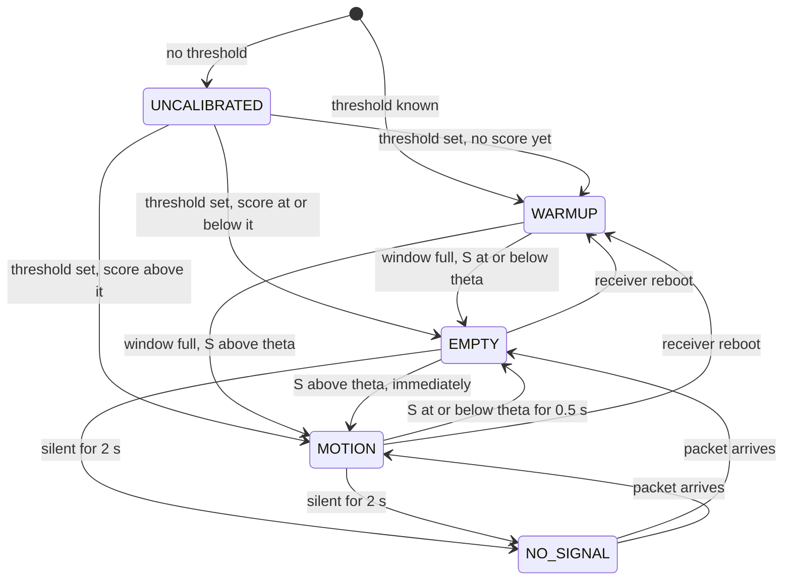

# Signal model and detection math

This note is the methods section for the Team 12 pipeline. It derives each processing stage from the
physics of the WiFi channel, then states the formula **exactly as the code computes it**, with the
real default constants, and cites the function or class that does it. Background physics is marked
**Background**. Everything else describes the code as it is, including the parts that are only
heuristics.

What the pipeline is, in one sentence: a per-link **band-limited energy detector** on CSI amplitude,
with thresholds set from **robust statistics** of the empty-room score. Its output is projected onto
the floor plan by a **back-projection with soft-AND fusion**.

What it is not: there is no machine learning, no Kalman or particle filter, no tracking, no
localisation or counting of individuals, and no tomographic inversion. Section 11 states the limits
in terms of the model.

---

## Overview

```mermaid
flowchart LR
  TX["Senders tx0, tx1<br/>ESP-NOW broadcast<br/>ch 6, HT40, 40 Hz"] -->|"multipath channel H(f,t)"| RX["Receivers rx1, rx2<br/>CSI per packet<br/>gain frozen after 100 pkts"]
  RX -->|"CSI_DATA lines, USB serial"| P["Parser, one per receiver<br/>int8 I/Q to amplitude<br/>null-subcarrier mask"]
  P --> M["Host-time watermark merge<br/>one stream, all receivers"]
  M --> L["Demultiplex by<br/>(receiver, sender MAC)<br/>= link"]
  L --> HP["3-stage high-pass<br/>tau = 0.16 s, device time"]
  HP --> S["1 s windowed variance<br/>mean over subcarriers<br/>score S"]
  S --> D["S above theta: MOTION now<br/>release after 0.5 s"]
  S --> E["Log-ratio evidence<br/>vs 60 s rolling median"]
  E --> F["Gaussian segment footprint<br/>soft-AND fusion"]
  F --> H["1 - exp(-1.3 x)<br/>rise/decay 0.3 s<br/>28 x 18 grid"]
  C["Calibration<br/>robust quantiles"] -.->|theta| D
```



| Stage | Statistic | Key defaults | Source |
|---|---|---|---|
| Parse | amplitude $A_k=\sqrt{I_k^2+Q_k^2}$ on 114 kept subcarriers | nulls 57, 58, 59 of 117 | `csi/parser.py` (`CSIParser`) |
| Score | variance of 3-stage high-passed amplitude over 1 s, mean over subcarriers | $\tau=0.16$ s, $W=1$ s, $N\ge5$ | `csi/detect.py` (`MotionScorer`) |
| Decide | $S\gt \theta$, zero-latency attack, 0.5 s release hold | $h=0.5$ s | `csi/detect.py` (`classify`, `_Debouncer`) |
| Calibrate | $\theta=1.25\thinspace Q_{0.99}$ (quiet) or $1.25\thinspace Q_{0.97}$ (noisy) or median + 6 robust sigma | 1 s chunks, 3x / 2.5x rejection | `csi/detect.py` (`calibrate_clips`), `csi/noisy_calibration.py` |
| Map | log-ratio evidence, Gaussian capsule, soft-AND, exponential saturation, asymmetric smoothing | $\sigma_F=0.35$ m, $\gamma=0.5$, $\kappa=1.3$ | `csi/heatmap.py` (`Heatmap`) |
| Time | 32-bit counter unwrap, host-time watermark merge | $2^{32}$ µs, 1 s stall | `csi/clock.py`, `csi/server.py` (`_Reorder`) |

### Notation

| Symbol | Meaning |
|---|---|
| $\ell$ | a link: one (receiver, sender MAC) pair, labelled e.g. `rx1<-00` (`csi/links.py`, `LinkId`) |
| $k\in\mathcal K$ | a kept subcarrier, $K=\lvert\mathcal K\rvert$ |
| $n$ | packet index on one link |
| $t_n$ | receiver device time of packet $n$ (µs counter, unwrapped) |
| $\tau_n$ | laptop host time when the line was read (`time.time()`) |
| $A_k[n]$ | amplitude of subcarrier $k$ in packet $n$ (int8 LSB units) |
| $y_k[n]$ | high-passed amplitude residual |
| $S_n$ | motion score of the link after packet $n$ (LSB²) |
| $\theta_\ell$ | the link's motion threshold; $\mu$ the calibration margin |
| $Q_q(\cdot)$ | empirical $q$-quantile (NumPy's default linear interpolation) |

---

## 1. Channel model (Background)

### 1.1 Multipath CSI

An OFDM receiver estimates, per packet, the complex channel frequency response on each subcarrier
$f_k=f_c+k\thinspace \Delta f$, with $\Delta f=312.5$ kHz. In a room the channel is a sum over propagation
paths, each with a complex gain $a_p$ and a delay $\tau_p=d_p/c$ for path length $d_p$:

```math
H_k(t)=\sum_{p=1}^{P} a_p(t)\,e^{-j2\pi f_k\,\tau_p(t)} .
```

Split the paths into those that do not touch a person (walls, furniture, line of sight) and those
that do:

```math
H_k(t)=\underbrace{\sum_{p\in\mathcal S} a_p\,e^{-j2\pi f_k\tau_p}}_{H_k^{\mathrm s}\ \text{(static)}}+\underbrace{\sum_{p\in\mathcal D} a_p(t)\,e^{-j2\pi f_k\tau_p(t)}}_{H_k^{\mathrm d}(t)\ \text{(body paths)}} .
```

The phase of a body path advances at a rate set by how fast its length changes, which ties the
fluctuation rate of the CSI directly to the body's speed:

```math
\frac{1}{2\pi}\frac{d}{dt}\Big(2\pi f_k\,\tau_p(t)\Big)=\frac{\dot d_p(t)}{\lambda_k}.
```

When the body paths are weak relative to the static field, $\lvert H^{\mathrm d}\rvert\ll\lvert H^{\mathrm s}\rvert$, the amplitude is to first order

```math
\lvert H_k(t)\rvert\approx\lvert H_k^{\mathrm s}\rvert+\sum_{p\in\mathcal D}\lvert a_p(t)\rvert\cos\!\Big(\frac{2\pi\,d_p(t)}{\lambda_k}+\phi_{k,p}\Big).
```

So a static room is a **constant** in amplitude, and every moving reflector adds a tone at
instantaneous frequency $\lvert\dot d_p\rvert/\lambda$. A reflector moving at speed $v$ changes a
bistatic path length at most at $2v$, so its tone lies below

```math
f_{\max}=\frac{2v}{\lambda}\approx 16\ \text{Hz}\quad\text{for } v=1\ \text{m/s},\ \lambda\approx 12.3\ \text{cm}.
```

Breathing moves the chest by millimetres at 0.1 to 0.5 Hz, the band `csi/breathing.py` searches. That
is a small, slow perturbation, close to DC.

**Our rig in these terms.** Both firmwares set channel 6 with HT40 and the secondary channel below
(`firmware/csi_recv/main/app_main.c`, `firmware/csi_send/main/app_main.c`), which puts the 40 MHz
channel near 2.43 GHz, $\lambda\approx12.3$ cm. The ESP32-C5 reports 117 subcarrier positions (234
int8 values). The parser drops positions 57, 58 and 59 as always null (`KNOWN_NULL_SUBCARRIERS`).
Those are the three bins at the centre of the 117, which matches the HT40 layout of subcarriers
$-58,\dots,58$ with DC nulls at $-1,0,+1$, leaving $K=114$. The kept band spans
$114\times312.5\ \text{kHz}\approx35.6$ MHz, so the delay resolution is $1/B\approx28$ ns, or about
8.4 m of path length. In a 2.77 m × 1.84 m room the individual paths cannot be resolved. The code
therefore does not try to decompose the channel into paths. It treats the 114 subcarriers as 114
correlated views of the same perturbation and uses second-order statistics.

### 1.2 Why amplitude and not phase

Sender and receiver run on independent crystals and share no clock. Every packet therefore carries
a fresh timing offset (packet-detection delay plus sampling-frequency offset) and a fresh common
phase (residual carrier-frequency offset, PLL phase):

```math
\angle\hat H_k[n]=\angle H_k[n]-2\pi k\,\Delta f\,\delta t_n+\psi_n+Z_k[n],
```

where $\delta t_n$ and $\psi_n$ are random from packet to packet. Raw phase is unusable as it stands.
Sanitising it (fitting and removing a linear phase across $k$) also removes any real
linear in $k$ phase change. The cross-antenna conjugate product that cancels these offsets on
multi-antenna NICs is not available, because these boards receive on one antenna.

Amplitude is immune to both offsets. It sees only the receiver gain $g_n$:

```math
\lvert\hat H_k[n]\rvert=g_n\,\lvert H_k[n]\rvert+\text{noise}.
```

The receiver firmware records its AGC and FFT gain over the first 100 packets after boot, then forces
the gain to that baseline (`CONFIG_FORCE_GAIN 1`, `esp_csi_gain_ctrl_set_rx_force_gain` in
`firmware/csi_recv/main/app_main.c`). So $g_n=g$ is constant for one boot of a receiver. This is the
"gain baseline" in the project docs, and Section 11 shows why a reset invalidates thresholds. The
observable the Python side receives is

```math
A_k[n]=\sqrt{I_k[n]^2+Q_k[n]^2},\qquad I_k,Q_k\in\lbrace-128,\dots,127\rbrace .
```

### 1.3 Fresnel zones and the line of sight

The boundary of the $m$-th Fresnel zone of a link from sender T to receiver R is the ellipsoid of
points P with excess path length $\lvert TP\rvert+\lvert PR\rvert-\lvert TR\rvert=m\lambda/2$. A body inside the first zone
perturbs the strongest (line-of-sight and near-line-of-sight) paths, and the effect falls off outside
it. At the midpoint of a link of length $d$ the first zone has radius

```math
r_1=\tfrac12\sqrt{\lambda d}.
```

For the current rig (`config/room.json`, $\lambda\approx12.35$ cm) this gives:

| Links | Length $d$ | $r_1$ at midpoint |
|---|---|---|
| `rx2<-01`, `rx1<-00` (left and right walls) | 1.84 m | 0.24 m |
| `rx2<-00`, `rx1<-01` (diagonals) | 3.33 m | 0.32 m |

The heatmap spreads each link's evidence along its segment with a Gaussian of
$\sigma_F=0.35$ m (`FALLOFF_M`), the same scale as $r_1$. That is the geometric prior. The code's
footprint is a constant-width capsule around the segment, not an ellipse that narrows to zero width
at the nodes (Section 6.3).

### 1.4 Why the variance of high-passed amplitude detects motion

Section 1.1 gives the argument. Static paths contribute DC. Breathing contributes energy below about
0.5 Hz. Walking puts energy up to $2v/\lambda$, roughly 16 Hz. A high-pass filter followed by a
windowed variance is therefore an estimate of amplitude power in a band above about 2 Hz:

```math
\mathbb E\big[S\big]\approx\frac{1}{K}\sum_{k\in\mathcal K}\int_{0}^{f_s/2}\lvert G(f)\rvert^2\,\Gamma_{A_k}(f)\,df,
```

where $G$ is the high-pass response (Section 3.1) and $\Gamma_{A_k}$ is the power spectral density of
subcarrier $k$'s amplitude. This is an **energy detector**, the classic test for an unknown signal in
noise. Two properties follow and are used later:

* **Aliasing is harmless.** At about 37 packets/s the Nyquist frequency is about 18.5 Hz, close to
  $f_{\max}$. Energy from faster motion folds back into the band but still counts as variance. Only
  energy that folds to near DC would be lost.
* **Homogeneity in gain.** The filter is linear, so $y\mapsto g\thinspace y$ and

```math
S[g\,A]=g^2\,S[A].
```

A change in receiver gain rescales every score on that receiver by $g^2$. Section 11 uses this.

---

## 2. From `CSI_DATA` to amplitude vectors

**Line format** (`csi/parser.py`, module docstring and `CSIParser._parse_csi`). Each receiver prints
one line per received packet:

```
CSI_DATA,<seq>,<mac>,<rssi>,...,<channel>,<local_timestamp>,...,<len>,<first_word>,"[i0,r0,i1,r1,...]"
```

The column layout comes from the header line the firmware prints at boot. If the port was opened after
boot and the header was missed, the parser matches the column count against the known layouts
(`DEFAULT_HEADER`, `C5_HEADER`). A line is rejected and counted as malformed if:

* the bracketed list is missing or partial,
* it has an odd number of values,
* a value lies outside the int8 range $[-128,127]$,
* the column count disagrees with the header, or
* the declared `len` disagrees with the list length.

The parser never raises on bad input.

**Amplitude** (`CSIParser._parse_csi`). Values come in (imaginary, real) pairs per subcarrier, and the
parser computes `np.hypot`, so the order does not matter:

```math
A_m[n]=\mathrm{hypot}\big(r_{2m}[n],\,r_{2m+1}[n]\big),\qquad m=0,\dots,M-1 .
```

**Null-subcarrier mask** (`CSIParser._admit`, `_finish_warm_up`, `_maybe_relock`). The kept set
$\mathcal K$ is locked once per raw layout:

* **Known layout.** For 234 raw values (ESP32-C5, $M=117$) the mask is fixed from hardware
  measurement:

```math
\mathcal K=\lbrace0,\dots,116\rbrace\setminus\lbrace57,58,59\rbrace,\qquad K=114 .
```

* **Unknown layout.** The first `WARMUP_PACKETS` = 20 packets of that length are held. A subcarrier
  is kept if it is non-zero in **any** of them:

```math
m\in\mathcal K\iff\max_{1\le j\le 20}A_m^{(j)}>0 .
```

  The held packets are then released in order. A single packet is not used, because at low CSI gain
  most values are 0 or ±1 and one packet's zeros are not a stable guard-band mask (code comment).
* **Re-lock.** If more than `RELOCK_FRACTION` × `RELOCK_WINDOW` = 0.8 × 50 = 40 of the last 50
  packets share a different raw length, the layout re-locks to it. Until then, packets of the wrong
  length are skipped and counted (`layout_skipped`).

Each emitted `CSIPacket` carries `host_ts` ($\tau_n$), `device_ts` (raw 32-bit µs counter), RSSI,
channel, the sender MAC and the float32 vector $A[n]\in\mathbb R^{K}$.

**Quantisation floor.** Uniform int8 quantisation adds about $1/12$ LSB² of variance per I/Q component.
For amplitudes well above 1 LSB, that projects to about $1/12$ LSB² on $A_k$. Quiet-room scores on the
four-link rig have medians of about 2 to 7 LSB² (README, "Results"), one to two
orders of magnitude higher. The empty-room floor is therefore set by noise sources other than
quantisation.

---

## 3. Per-link motion statistic

Each link has its own `MotionScorer` (`csi/links.py`, `_Link`). Everything in this section runs in
that link's **device time**: the receiver's own microsecond counter, unwrapped as in Section 9.1.
Serial and USB batching therefore add no jitter, and dropped packets leave gaps in time instead of
squeezing it.

### 3.1 Three-stage exponential high-pass

`csi/detect.py`, `MotionScorer._highpass`, with `HIGHPASS_TAU_S` $\tau=0.16$ s and `HIGHPASS_STAGES` = 3.
For each packet, with $\Delta t_n=t_n-t_{n-1}$ in seconds,

```math
\alpha_n=1-e^{-\Delta t_n/\tau}.
```

Stage $i=1,2,3$ keeps a running mean $s^{(i)}_k$ and passes on the residual. The code updates the mean
first and then subtracts it:

```math
s^{(i)}_k[n]=s^{(i)}_k[n-1]+\alpha_n\big(x^{(i)}_k[n]-s^{(i)}_k[n-1]\big),\qquad x^{(i+1)}_k[n]=x^{(i)}_k[n]-s^{(i)}_k[n],
```

with $x^{(1)}=A$ and residual $y=x^{(4)}$. On the first packet, $s^{(1)}=A[0]$, $s^{(2)}=s^{(3)}=0$ and
$y[0]=0$, so there is no start-up transient.

*Irregular sampling.* Because $\alpha_n$ depends on the actual gap, the update is the exact solution of
$\dot s=(x-s)/\tau$ over $[t_{n-1},t_n]$ for an input held at the new sample. A 100 ms gap from lost
packets advances the mean by $1-e^{-0.625}\approx0.47$ of the way, as it should.

*Frequency response.* At a uniform packet interval $\Delta t$, write $\beta=e^{-\Delta t/\tau}$. Each
stage is the first-order high-pass $\beta(1-z^{-1})/(1-\beta z^{-1})$, so the cascade is

```math
G(z)=\left(\frac{\beta\,(1-z^{-1})}{1-\beta z^{-1}}\right)^{3}.
```

As $\Delta t\to0$ this tends to the analogue cascade $G(s)=\big(s\tau/(1+s\tau)\big)^{3}$. The figures
below are computed from these constants at 37 to 40 packets/s, relative to the passband:

| Frequency | Relative gain of the cascade | What lives there |
|---|---|---|
| 0.3 Hz | about −32 dB | breathing |
| 0.5 Hz | about −21 dB | fast breathing |
| 1.0 Hz | about −9 dB | slow sway |
| about 2 Hz | −3 dB (half-power point) | |
| 5 Hz and above | within 1 dB of the passband | walking |

The code comment on `HIGHPASS_STAGES` quotes the first two figures. Each single stage has its corner
at $1/(2\pi\tau)\approx1$ Hz, which matches the module docstring's "below about 1 Hz". The cascade's
half-power point is about 2 Hz. Because the code subtracts the updated mean, the discrete
filter's peak gain at Nyquist is $2\beta/(1+\beta)$ per stage, about −2 dB for the cascade. Every
threshold is calibrated through the same filter, so this constant factor cancels.

*Robustness.* A packet whose unwrapped device time is not later than the last accepted one is dropped
and counted (`MotionScorer.dropped`). A receiver reboot (`RESET` from `DeviceClock`) clears the
filter state and the window.

### 3.2 Windowed variance

`csi/detect.py`, `MotionScorer.push`, with `WINDOW_S` $W=1$ s and `MIN_WINDOW_PACKETS` = 5. The window
holds the residuals of the last second of device time:

```math
\mathcal W_n=\lbrace i:\ t_n-t_i\le W\rbrace .
```

The score is the population variance (`np.var`, ddof = 0) of each subcarrier's residual over the
window, averaged over subcarriers. Equivalently, it is the normalised trace of the window's sample
covariance:

```math
S_n=\frac{1}{K}\sum_{k\in\mathcal K}\frac{1}{\lvert\mathcal W_n\rvert}\sum_{i\in\mathcal W_n}\big(y_k[i]-\bar y_k\big)^2=\frac{1}{K}\mathrm{tr}\hat\Sigma_{y}(n)\qquad\text{(3.1)}
```

$S_n$ is defined only when $\lvert\mathcal W_n\rvert\ge5$ and the window spans at least
$0.9\thinspace W=0.9$ s. Otherwise the scorer returns `None` and the link reports WARMUP. At 36 to 38
packets/s a full window holds about 37 packets × 114 subcarriers.

*Onset latency.* The detector has no attack delay (Section 4). Suppose motion of window-variance $S_1$
replaces quiet of $S_0$. The residual has roughly zero mean, so the window variance mixes roughly
linearly, and $S$ crosses $\theta$ once a fraction

```math
\phi^\ast=\frac{\theta-S_0}{S_1-S_0}
```

of the 1 s window holds motion, so detection latency is a fraction of a second.

*Measured scale.*

| Setup | Empty | Walking | Source |
|---|---|---|---|
| Single link, receiver and sender about 2 m apart | about 3 to 9 | about 25 to 70 | `csi/common.py`, `--threshold` help |
| Four-link rig | medians about 2 to 7, thresholds about 8 to 20 | | README, "Results" |
| C5 receiver on the top wall, one walk test | quiet maximum about 11 | 25 to 31 | README, "Placement hints" |
| Simulator | about 0.2 | about 3 to 9 | `csi/detect.py`, `SIM_THRESHOLD` comment |

---

## 4. Decision rule

### 4.1 Threshold and asymmetric debounce

`csi/detect.py`, `classify`, with breathing off (the default):

```math
\hat q_n=\text{MOTION}\ \text{ if } S_n>\theta_\ell,\qquad \hat q_n=\text{EMPTY}\ \text{ otherwise}.
```

`_Debouncer` with `DEBOUNCE_S` $h=0.5$ s, in **host time**:

| Current state | Raw $\hat q_n$ | Next state |
|---|---|---|
| any | MOTION | **MOTION immediately** (zero attack latency) |
| MOTION | EMPTY | MOTION until raw EMPTY has persisted for $h=0.5$ s; any raw MOTION restarts the hold |
| EMPTY | EMPTY | EMPTY |

This is hysteresis in time, and it is deliberately asymmetric. The use case treats a missed person as
the costly error (`docs/agents/project-context.md`), so entering MOTION costs no delay and only
leaving it is debounced. The dashboard also shows the level $S_n/\theta_\ell$ (`level` and
`normalised` in the payload, `csi/links.py` and `csi/dashboard.py`).

### 4.2 Link state machine

`csi/links.py`, `_Link.push`, `_Link.set_threshold`, `LinkMonitor.snapshot`. Precedence, highest
first:

| State | Condition | Constant |
|---|---|---|
| NO_SIGNAL | no packet on this link for more than 2 s of host time. This is reported by `snapshot` and masks the underlying state | `NO_SIGNAL_S` = 2.0 |
| UNCALIBRATED | no threshold (fixed mode) | |
| WARMUP | threshold set but $S_n$ undefined: window not yet full, or just after a receiver reboot | $W=1$ s, $N\ge5$ |
| EMPTY / MOTION | debounced $\hat q_n$ | $h=0.5$ s |



### 4.3 Room-level fusion

`csi/adaptive.py`, `RoomDecision`, driven by `LinkMonitor._update_room` on every packet in **both**
modes. Over the links heard within the last 2 s:

```math
R=\text{MOTION}\iff\Big(\sum_{\ell}\mathbf 1\big[\ell\ \text{elevated}\big]\ge2\Big)\ \lor\ \big(\exists\,\ell:\ \ell\ \text{strong}\big),
```

which is then debounced like Section 4.1 with $h=1.0$ s (`ROOM_HOLD_S`). In fixed mode a link is
elevated exactly when it is in MOTION and is never strong, so the room rule reduces to a **2-of-N
vote**. The result is in the payload as `status.room` and is used by the redesigned page
(`web/ui-overhaul/`). The offline evaluator fuses differently: it uses a 1-of-N OR (Section 10).

The transceiver pipeline does not use this rule: at 870 links a 2-of-N vote fires by chance, and the links of one
node fail together. Its room state (`csi/room_state.py`) asks for agreement at one place among links that share no
node, scaled to the links that cross there; [ADR-0029](adr/0029-adaptive-baseline-only-and-a-room-state-from-zones.md)
gives the rule and its numbers. Because a still person leaves $S$ (Section 11), a zone that leaves MOTION reads
POSSIBLY_OCCUPIED for 60 s before EMPTY ([ADR-0030](adr/0030-possibly-occupied-hold.md)).

---

## 5. Calibration as robust statistics

A threshold is a statement about the **null distribution** of $S$, the distribution of scores with
nobody moving. All three calibration paths estimate a high quantile of that distribution while
guarding against contamination by movement. They differ in how much contamination they assume.

**Preconditions** (`csi/detect.py`, `calibrate_clips`). Each clip is cut at the last receiver reboot
in it (`_since_last_reboot`). The send rate is estimated robustly to drops (`estimate_rate_hz`). Drops
make some intervals 2× or 3× the period, so the estimator anchors on the lower decile:

```math
\hat f=\frac{10^6}{\mathrm{median}\big\lbrace\Delta_i:\ \Delta_i\le1.5\,Q_{0.10}(\Delta)\big\rbrace},\qquad L=\max\Big(0,\ 1-\frac{N}{D\hat f+1}\Big),
```

where $\Delta_i$ are the positive device-time intervals in µs, $N$ packets span $D$ seconds, and $L$ is
the loss. A link is refused if any of its clips has an effective rate $N/D\lt 15$ packets/s
(`MIN_CALIBRATION_PKT_RATE_HZ`) or a loss $L\gt 0.6$ (`MAX_CALIBRATION_LOSS`).

### 5.1 Quiet-room rule (terminal tools, or dashboard with "noisy room" unticked)

`csi/detect.py`, `calibrate_clips(noisy=False)`. Each clip is scored by a fresh `MotionScorer`, so no
window spans two clips. Every window score $S_i$ is assigned to a 1 s chunk $j=\lfloor(t_i-t_0)/1\thinspace \mathrm s\rfloor$
(`CHUNK_S`). Let $m_j$ be chunk $j$'s median and $J$ the number of chunks pooled over all clips. The
**quiet baseline** is the median of the lower half of the chunk medians, roughly their first quartile:

```math
B=\mathrm{median}\big(m_{(1)},\dots,m_{(\max(1,\lfloor J/2\rfloor))}\big).
```

A chunk is rejected as contaminated if either test fires: its median is too high (someone moving,
`REJECT_RATIO` = 3), or its upper tail is too heavy (a passer-by inside the chunk, `BURST_RATIO` = 2.5):

```math
m_j>3B\qquad\text{or}\qquad Q_{0.90}(\text{chunk } j)>2.5\,m_j .
```

The link is refused unless the kept ("clean") time satisfies both $T_{\text{clean}}\ge8$ s
(`MIN_CLEAN_S`) and $T_{\text{clean}}\ge0.5\thinspace T_{\text{total}}$ (`MIN_CLEAN_FRACTION`). Otherwise the
threshold is

```math
\theta_\ell=\mu\cdot Q_{0.99}\big(\lbrace S_i:\ i\in\text{kept chunks}\rbrace\big),\qquad\mu=1.25 .\qquad\text{(5.1)}
```

The margin $\mu$ is `DEFAULT_MARGIN`, set with `--margin` or the dashboard's Margin field.

### 5.2 Noisy-room rule (dashboard default)

`calibrate_clips(noisy=True)`, used by `csi/live_calibration.py`. The defaults are 3 clips × 10 s,
3 s pauses, a 5 s countdown and `noisy` true. Chunks are still classified, but only to write the
warning. Every window counts:

```math
\theta_\ell=\mu\cdot Q_{0.97}\big(\lbrace S_i:\ \text{all windows}\rbrace\big).\qquad\text{(5.2)}
```

*Breakdown point.* Suppose a fraction $\varepsilon$ of windows is movement lying entirely above the
clean distribution $F_0$. The pooled 97th percentile is then a clean quantile:

```math
Q_{0.97}\big((1-\varepsilon)F_0+\varepsilon F_1\big)=F_0^{-1}\!\Big(\frac{0.97}{1-\varepsilon}\Big),\qquad\varepsilon\le0.03 .
```

So (5.2) tolerates up to 3 % movement windows before the threshold starts to follow the movement
distribution. Its breakdown point against upper-tail contamination is 3 %.

### 5.3 Formula for a room that is never empty (`scripts/calibrate.py`)

`csi/noisy_calibration.py`, `link_threshold`. The script polls `/api/state` every 0.25 s (`POLL_S`) for
45 s (`DEFAULT_SECONDS`). Over the usable scores $x$ of one link, with $m=\mathrm{median}(x)$:

```math
s_-=\mathrm{median}\big\lbrace m-x:\ x\le m\big\rbrace,\qquad\theta_\ell=\max\big(m+6\times1.4826\,s_-,\ \ 3m\big).\qquad\text{(5.3)}
```

$s_-$ is a **lower-half MAD**. For symmetric noise it equals the ordinary MAD, and $1.4826=1/z_{0.75}$,
where $z_{0.75}\approx0.6745$ is the upper quartile of the standard normal, makes it a consistent
estimate of $\sigma$ under Gaussian noise [1, 2]. Movement adds only upper-tail
mass, so it reaches (5.3) only through the median, which has a 50 % breakdown point. It never reaches
the spread. The floor $3m$ protects against an optimistic spread, since a variance-type score is
right-skewed and its lower half is narrower than its upper half. A link with fewer than 40 usable
scores, or fewer than half of its readings usable, gets no threshold (`MIN_SCORES`,
`MIN_USABLE_FRACTION`).

### 5.4 Remarks

* **Detection-theoretic reading.** (5.1) and (5.2) are Neyman–Pearson-style designs. They fix the false
  alarm rate by placing $\theta$ at an empirical quantile of the null. The nominal per-window false
  alarm probability is 1 % or 3 % before the margin, and $\mu=1.25$ lowers it further if the null is
  stationary.
* **Effective sample size.** Scores are produced per packet over overlapping 1 s windows, so adjacent
  scores share about 97 % of their samples. The default 30 s of clips yields about a thousand scores
  but only about 30 nearly independent windows. A 99th percentile of 30 effective samples sits close
  to their maximum, and the margin absorbs that estimation noise.
* **Scale equivariance.** Medians, MADs and quantiles are all positively homogeneous. With
  $S\mapsto g^2S$, every rule gives $\theta\mapsto g^2\theta$. Recalibrating after a receiver
  re-baseline therefore restores the same operating point.
* **Open question.** On 2026-11-07, (5.3) and the dashboard button gave 137.0 and 50.2 for the same link
  (`rx2<-00`, an S3 receiver at the time). Neither was checked against labelled motion, so no winner
  is declared (`docs/agents/hardware.md`).

**Measured** (README, "Calibration margin", single-link session hw5):

| Margin $\mu$ | Empty windows read as MOTION | Walking windows read as MOTION |
|---|---|---|
| 1.0 | 14 % | 100 % |
| 1.1 | 11 % | 100 % |
| **1.25 (default)** | **6 %** | **100 %** |
| 1.5 | 5 % | 100 % |

At $\mu=1.25$ the measured 6 % is above the nominal 1 %. Two effects in the model can account for
that. The null distribution drifted between the calibration and the validation recordings, and the
0.5 s release hold stretches every false crossing into at least 0.5 s of MOTION.

---

## 6. Spatial inference: the heatmap

`csi/heatmap.py`, `Heatmap.advance`, geometry in `csi/room.py`. The map turns per-link scores into a
field over the floor plan by back-projection: each link's evidence is smeared along its own segment,
as in unfiltered back-projection in tomography. There is no inversion step: instead of solving a
regularised least-squares problem, this code combines the footprints with a nonlinear,
agreement-rewarding rule.

### 6.1 Per-link quiet baseline

`QuietBaseline`, with `BASELINE_WINDOW_S` = 60 s, `BASELINE_PERCENTILE` = 50 and `BASELINE_WARMUP_S` =
10 s, in host time. At each heatmap step (Section 6.6), the link's newest score is pushed if it comes
from a packet the baseline has not seen yet, and only while the link's state is EMPTY or MOTION:

```math
b_\ell(\tau)=\mathrm{median}\big\lbrace S_\ell(\tau'):\ \tau-60\,\mathrm s\le\tau'\le\tau\big\rbrace,
```

defined once the samples span at least 10 s. The baseline is a median rather than a low percentile.
On the real rig, a noisy link's 20th percentile sat at the bottom of its own noise and made every spike
look like 3× evidence (module docstring).

The heatmap judges each link against this baseline rather than its threshold for a measured reason.
On the real rig a walking person lifted a link to only about 0.6 to 0.8 of its threshold (module
docstring), so threshold-relative evidence was almost always zero.

### 6.2 Log-ratio evidence

`link_evidence`, with `R_FLOOR` $r_0=1.2$ and `R_FULL` $r_1=3.0$:

```math
e_\ell=\mathrm{clip}_{[0,1]}\!\left(\frac{\ln\!\big(S_\ell/(r_0\,b_\ell)\big)}{\ln(r_1/r_0)}\right)=\mathrm{clip}_{[0,1]}\!\left(\frac{\Lambda_\ell-0.79\ \mathrm{dB}}{3.98\ \mathrm{dB}}\right),\qquad\Lambda_\ell=10\log_{10}\frac{S_\ell}{b_\ell}.\qquad\text{(6.1)}
```

Evidence is linear in the score excess measured in decibels. There is a dead zone up to 0.79 dB
(1.2×), and evidence reaches 1 at 4.77 dB (3×). For example, 1.5× gives 0.24 and 2× gives 0.56. Two
properties make this the natural scale:

* **Gain-invariant.** $\ln(g^2S/g^2b)=\ln(S/b)$, so (6.1) is unchanged by a receiver re-baseline once
  $b_\ell$ has caught up.
* **Likelihood-ratio ordering.** Consider the usual model for a variance-type score: a scaled gamma
  or chi-square of fixed shape, with motion multiplying its level. That family has a monotone
  likelihood ratio in $S/b$, so thresholding the ratio is the corresponding likelihood-ratio test for
  a level increase (Karlin–Rubin). The log puts the ratio on an additive, decibel scale.

A link contributes only if its state is EMPTY or MOTION (`CONTRIBUTING_STATES`), its baseline is
warm, and $e_\ell\gt 0$.

### 6.3 Geometric prior: Gaussian segment footprint

`cell_centres`, `segment_falloff`, `point_segment_distance`. The grid has `COLS` × `ROWS` = 28 × 18
cells over the room, about 9.9 cm × 10.2 cm each on the 2.77 m × 1.84 m rig. Let
$\mathbf x_{\mathrm{rx}}$ and $\mathbf x_{\mathrm{tx}}$ be the link's endpoints. For a cell centre
$\mathbf c$, the distance to the segment (projection clamped to the ends) and the footprint are

```math
d_\ell(\mathbf c)=\min_{u\in[0,1]}\big\lVert\mathbf c-\mathbf x_{\mathrm{rx}}-u\,(\mathbf x_{\mathrm{tx}}-\mathbf x_{\mathrm{rx}})\big\rVert,\qquad F_\ell(\mathbf c)=\exp\!\Big(-\frac{d_\ell(\mathbf c)^2}{2\sigma_F^2}\Big),\quad\sigma_F=0.35\ \mathrm m.
```

Each link's contribution is weighted by $w_\ell$ (`link_weights` in `config/room.json`, default 1;
currently 0.3 for `rx1<-01`):

```math
p_\ell(\mathbf c)=w_\ell\,e_\ell\,F_\ell(\mathbf c).
```

This footprint has constant width along the whole segment, a capsule. A Fresnel ellipse narrows to
zero width at the nodes (Section 1.3), so near the nodes the capsule is a wider prior than the physics
suggests. The simulator uses the same shape with $\sigma=0.25$ m to generate synthetic link responses
(`csi/room.py`, `FALLOFF_SIGMA_M`, `link_responses`).

### 6.4 Soft-AND fusion

`Heatmap._combine`, with `AGREEMENT` $\gamma=0.5$. Sort the contributions at each cell and let
$p_{(1)}(\mathbf c)\ge p_{(2)}(\mathbf c)$ be the two largest. Then

```math
\Phi(\mathbf c)=(1-\gamma)\sum_{\ell}p_\ell(\mathbf c)+\gamma\sqrt{p_{(1)}(\mathbf c)\,p_{(2)}(\mathbf c)}.\qquad\text{(6.2)}
```

The geometric-mean term is added only when at least two links contribute. The first term behaves
like an OR: any link adds heat. The second behaves like an AND: it is large only where the two
strongest links agree. A lone noisy link is therefore capped at $(1-\gamma)=0.5$ of its footprint,
and a crossing of two links that both see change is boosted.

### 6.5 Soft saturation

`SENSITIVITY` $\kappa=1.3$:

```math
T(\mathbf c)=1-e^{-\kappa\,\Phi(\mathbf c)}.\qquad\text{(6.3)}
```

Worked values from (6.2) and (6.3) at the defaults:

| Situation at a cell | $\Phi$ | $T$ |
|---|---|---|
| one link, full evidence, on its segment | 0.50 | 0.48 |
| two links, full evidence, crossing here | 1.50 | 0.86 |
| the rig's two diagonals at the room centre, both at full evidence, `rx1<-01` weighted 0.3 | 0.92 | 0.70 |

### 6.6 Temporal smoothing

`Heatmap._smooth`, with `RISE_TAU_S` = `DECAY_TAU_S` = 0.3 s and `STEP_S` = 0.1 s, in host time. Each
cell relaxes towards its target with a time constant that depends on direction:

```math
V(\mathbf c)\leftarrow\mathrm{clip}_{[0,1]}\Big(V+\big(T-V\big)\big(1-e^{-\Delta\tau/\tau_\pm}\big)\Big),
```

where $\tau_\pm=\tau_{\text{rise}}$ if $T\gt V$ and $\tau_\pm=\tau_{\text{decay}}$ otherwise.

With the defaults a cell reaches 63 % of a step in 0.3 s and 95 % in 0.9 s. The structure allows
separate rise and decay constants, but the defaults are equal. The grid advances at most every 0.1 s
on packet arrival, and again at every 0.2 s frame (`csi/server.py`, `FRAME_INTERVAL_S`). Sensitivity,
rise, decay and falloff can be changed live (`Heatmap.set_params`, `POST /api/params`).

### 6.7 Transceiver rooms: regularised radio tomography

`csi/rti.py`, used by `Heatmap` when the room has transceivers ([ADR-0025](adr/0025-radio-tomography-heatmap.md)).
Sections 6.3 to 6.4 stay for rooms of receivers and senders. With $M$ links and $N$ cells, let
$y_\ell=w_\ell e_\ell$ be the weighted evidence of (6.1), $d_\ell$ the link length and $d_{\ell1}(\mathbf c)$,
$d_{\ell2}(\mathbf c)$ the distances from a cell centre to the link's two nodes. The weight model is the
normalised ellipse of Wilson and Patwari (VRTI eq. 14), with excess path $\lambda=0.2$ m:

```math
W_{\ell\mathbf c}=\begin{cases}1/\sqrt{d_\ell} & d_{\ell1}(\mathbf c)+d_{\ell2}(\mathbf c)\le d_\ell+\lambda\ 0 & \text{otherwise}\end{cases}
```

(cells within half a cell of the segment always count). With a Gaussian prior on the image,
$[C_x]_{kl}=\exp(-\lVert\mathbf c_k-\mathbf c_l\rVert/\delta_c)$ with $\delta_c=1.0$ m, and noise-to-prior
variance ratio $r=30$, the MAP estimate (RTI eq. 12-13) is a fixed linear map of the evidence:

```math
\hat{\mathbf x}=\Pi\,\mathbf y,\qquad\Pi=\big(W^\top W+r\,C_x^{-1}\big)^{-1}W^\top=C_xW^\top\big(WC_xW^\top+r\,I\big)^{-1}.\qquad\text{(6.4)}
```

The second form, by the matrix inversion lemma, solves an $M\times M$ system and never inverts $C_x$. $\Pi$
depends only on geometry, so it is computed once per layout. The image is divided by
$x_{\mathrm{ref}}$, the median over covered cells $\mathbf c$ of $(\Pi \mathbf 1_{\mathbf c})_{\mathbf c}$,
where $\mathbf 1_{\mathbf c}$ sets every link whose ellipse covers $\mathbf c$ to 1: one person at full
evidence is about 1. Negative values are clipped, and (6.3) and Section 6.6 follow as before. Unlike
(6.2), every link that covers a cell counts towards it, so heat sharpens as links are added.

---

## 7. Breathing band (experimental, off by default)

`csi/breathing.py`, `estimate_breathing`, driven by `_BreathingTracker` in `csi/detect.py`. It is
enabled only with `breathing=True` / `--breathing`. The input is a 15 s window (`WINDOW_S`) of raw
amplitude vectors in device time, re-estimated at most once per second. It needs at least 8 packets
and a span of at least 0.97 × 15 s. The tracker is reset whenever $S\gt \theta$, because motion
contaminates the window, and MOTION always overrides breathing in `classify`.

1. **Resample** onto a uniform grid at $f_s=1/\mathrm{median}(\Delta t)$ by linear interpolation,
   so drops leave interpolated gaps instead of stretching the frequency axis.
2. **Band-limit** each subcarrier: subtract the mean and a least-squares line, apply a Hann taper, take
   the rFFT, zero every bin outside $[0.1,0.5]$ Hz (6 to 30 breaths/min), and invert. The taper stays
   on the output.
3. **Select** the `TOP_K` = 10 subcarriers with the largest in-band variance and standardise each to
   unit variance.
4. **PCA by SVD** of the centred $n\times10$ matrix $X=U\Sigma V^{\top}$. The breathing candidate is
   the first principal component $\sigma_1\mathbf u_1$, and the coherence statistic is

```math
\rho=\frac{\sigma_1^2+\sigma_2^2}{\sum_i\sigma_i^2}.
```

5. **Peak** of the Hann-windowed, 8× zero-padded power spectrum $P$ of the component inside the band,
   refined by parabolic interpolation:

```math
\delta=\frac{1}{2}\,\frac{P_{k-1}-P_{k+1}}{P_{k-1}-2P_k+P_{k+1}},\qquad\hat f=f_{k}+\delta\,\Delta f_{\text{pad}},\qquad\text{bpm}=60\hat f\ \ \text{if }\rho\ge0.85 .
```

Zero padding interpolates the spectrum. It does not add resolution, which stays near $1/15$ Hz.

*Why it false-fires (model view).* The statistic $\rho$ assumes that independent noise spreads across
the 10 channels while breathing concentrates in one or two. Its degrees of freedom are limited by the
window's time-bandwidth product:

```math
2BT=2\times(0.5-0.1)\ \mathrm{Hz}\times15\ \mathrm s=12 .
```

Ten band-limited, Hann-tapered signals live in a subspace of at most about 12 real dimensions, so even
pure noise gives a large top-two share. A common-mode in-band fluctuation, such as slow drift shared
by all subcarriers, is coherent by construction and passes the test as breathing would. **Measured:**
43 % of empty windows (1305 of 3065) read STILL_PRESENT on hw5 (README, "Breathing"). That is why it is
off.

---

## 8. Adaptive thresholds (experimental, `--auto-threshold`)

`csi/adaptive.py`, `AdaptiveDetector` per link, in host time. This is a CFAR-style detector: the
threshold tracks a running robust estimate of the link's own noise level, so it needs no calibration.
Over the last `WINDOW_S` = 75 s of samples, with statistics refreshed at most every 0.25 s
(`RECALC_S`):

```math
b=\mathrm{median}(S),\qquad\hat\sigma=1.4826\cdot\mathrm{median}\lvert S-b\rvert,
```

```math
\theta_{\text{enter}}=\max\big(b+5.5\,\hat\sigma,\ 2b\big),\qquad\theta_{\text{exit}}=\max\big(b+2.5\,\hat\sigma,\ 1.5\,b\big).\qquad\text{(8.1)}
```

* **Warm-up.** The detector reports WARMUP for the first 10 s (`WARMUP_S`) and until it has 20 samples
  (`MIN_SAMPLES`).
* **Hysteresis and minimum duration.** A link becomes elevated (MOTION) once $S\ge\theta_{\text{enter}}$
  has held for 0.6 s (`MIN_DUR_S`). Precisely: the timer starts at the first sample at or above
  $\theta_{\text{enter}}$, is reset only by a sample below $\theta_{\text{exit}}$, and fires on a sample
  at or above $\theta_{\text{enter}}$ that is at least 0.6 s later. The link leaves MOTION on the first
  sample below $\theta_{\text{exit}}$.
* **Strong.** A link is strong when it is elevated and $S\ge2\thinspace \theta_{\text{enter}}$ has held for
  0.6 s.
* **Level shift (rebuild).** Take the last `CAP_S` = 30 s, which must span at least 27 s. If at least
  80 % of its samples were high ($S\ge\theta_{\text{enter}}$), or at least 80 % were low
  ($S\le b/2$), the baseline is rebuilt from those 30 s alone. A receiver re-baseline, or a room that
  stays busy, is relearned in about 24 to 30 s.
* **Room.** The room is MOTION when at least 2 links are elevated or any link is strong, with a 1 s
  release hold (Section 4.3).

Every term in (8.1) scales with $g^2$, so the detector is scale-equivariant and recovers by itself from
a gain re-baseline. The docstring records that a re-baseline moves scores by 3 to 5×. The trade-off is
measured only qualitatively: it was less sensitive to walking than the fixed thresholds, because the
room needs two links to agree (`docs/agents/project-context.md`, README "Dashboard options").

---

## 9. Time base and multi-source synchronisation

The pipeline runs on two clocks, and each quantity uses the one that suits it:

| Clock | Used for | Why |
|---|---|---|
| Device time $t$: receiver's 32-bit µs counter, unwrapped | high-pass $\alpha_n$, the 1 s motion window, calibration chunks, the breathing grid, drop counting | free of USB/serial batching jitter, and drops leave gaps instead of compressing time |
| Host time $\tau$: laptop `time.time()` at `readline` | debounce, NO_SIGNAL, heatmap baseline and smoothing, adaptive detector, room decision, live-calibration clip cutting, cross-receiver merge | receivers share no clock, so anything that compares links needs a common one |

### 9.1 Unwrapping the device counter

`csi/clock.py`, `DeviceClock.advance`. The counter wraps every $2^{32}$ µs, about 71.6 min, and restarts
at 0 when a receiver reboots. Let $\Delta=r_n-r_{\text{last}}$ be the step in the raw counter.

* If $\Delta\ge-10^6$ µs (`REORDER_US`), the step is normal. A small negative step is an out-of-order
  packet and does not move $r_{\text{last}}$.
* Otherwise the backward step is a **wrap** if the host clock agrees with the wrapped step:

```math
\Big\lvert\frac{r_n+2^{32}-r_{\text{last}}}{10^6}-(\tau_n-\tau_{\text{last}})\Big\rvert\le\max\big(0.5\ \mathrm s,\ 0.5\,(\tau_n-\tau_{\text{last}})\big),
```

  and the offset grows by $2^{32}$. If there is no usable host gap, it is a wrap only if
  $r_{\text{last}}\ge2^{31}\gt r_n$.
* Any other backward step is a **reset** (reboot). The offset returns to 0, and every consumer clears
  state built on the old timeline: the scorer's filter and window, the breathing window and the health
  baseline.

The output is $t_n=r_n+\text{offset}$.

### 9.2 Link health

`csi/health.py`, `LinkHealth`. The send rate is the configured `--rate` if given. Otherwise it is
$10^6/\mathrm{median}$ of the last 200 positive device-time intervals, once at least 50 exist.
Each in-order step adds to the drop counter:

```math
\text{drops}\mathrel{+}=\max\big(0,\ \mathrm{round}(\Delta t\cdot\hat f)-1\big).
```

The packet rate is the number of packets in the last 2 s of host time divided by 2.

### 9.3 Merging receivers

`csi/multisource.py` reads each receiver on its own thread with its own parser, so one receiver's
layout warm-up or bad lines never touch another's. `csi/server.py`, `_Reorder`, then releases
packets in **host-time order** with a watermark. A receiver $r$ is active while it has sent within
1.0 s of wall time (`REORDER_STALL_S`). A connected receiver that has not yet sent is waited for during
the first 2.0 s (`REORDER_STARTUP_S`). The watermark is the newest host time that every active receiver
has reached:

```math
\Omega=\min_{r\ \text{active}}\ \tau^{\text{newest}}_r .
```

All packets with $\tau\le\Omega$ are released. Each receiver's stream is already in order, so
everything at or before $\Omega$ is complete. The resulting state does not depend on thread timing, a
stalled receiver cannot freeze the others, and a fast receiver cannot run ahead of a slow one. Frames
are emitted every 0.2 s of packet time (`FRAME_INTERVAL_S`). Between packets on live hardware, the
clock is advanced by wall time, so silent links turn NO_SIGNAL.

**Live calibration clips** (`csi/live_calibration.py`, `CalibrationJob.observe`). Clips are cut in host
time. Let $\rho=\tau-\tau_0$ be the time since recording started, with clip length $T_c=10$ s and
pause 3 s. Then

```math
(k,\ o)=\mathrm{divmod}(\rho,\ T_c+3\ \mathrm s),
```

and a packet belongs to clip $k$ if $k$ is less than the number of clips and $o\lt T_c$.

---

## 10. Evaluation metrics

`csi/evaluate.py`, `evaluate_sessions`. Per session folder:

1. The first `empty` recording, by start time, calibrates $\theta$ with rule (5.1).
2. Every other recording is replayed through `detect_packets`, the same code path as live.
3. Each emitted decision (one per packet, over its trailing window) is paired with its file's label:
   `walking` → MOTION, `empty` → EMPTY, `still_*` → STILL_PRESENT.

Splits are **by recording, never by random window**. Overlapping 1 s windows from the same recording
are strongly correlated, and a random split would leak.

The confusion matrix $C[u,v]$ counts decisions with true label $u$ and predicted state $v$. The
per-label accuracy is

```math
\mathrm{acc}(u)=\frac{C\big[u,\ v^\ast(u)\big]}{\sum_{v}C[u,v]},
```

where $v^\ast(u)$ is the expected state. With breathing off, the `still_*` rows are printed as
"breathing disabled" rather than scored 0 %. When a session holds several sender MACs, each sender is
calibrated and detected on its own. The room decision at each link reading is then the **OR** of the
links' latest states: MOTION if any link says MOTION (`_combine`).

**Results** (README, "Results"; all single-link, one C5 receiver and one S3 sender
about 2 m apart, channel 6):

| Session | Result |
|---|---|
| hw5, gain locked | walking: 100 % MOTION (2621 windows); empty validation recording: 94 % EMPTY at $\mu=1.25$, 95 % at $\mu=1.5$ |
| hw3, gain not yet locked | walking: 80 % MOTION; only one empty recording, used for calibration, so empty was not scored |
| hw5 with `--breathing` | 43 % of empty windows read STILL_PRESENT |

The 2621 walking windows are per-packet decisions over overlapping windows, not 2621 independent
trials. **There are no labelled accuracy figures for the current four-link rig.** The repository has
no labelled recording of it (`docs/agents/project-context.md`).

---

## 11. Known limits, in the language of the model

* **Stillness is invisible to $S$ by construction.** A person standing still is part of the static
  field $H^{\mathrm s}$. When they stop, the amplitude takes a step, and a step is DC to a high-pass
  filter: the cascade's transient dies out in about $6\tau\approx1$ s. Breathing is attenuated by 21
  to 32 dB (Section 3.1). So $S$ returns to the empty-room level within one to two seconds (the filter
  transient plus the 1 s window). A second, slower mechanism applies to a person who keeps moving
  slightly in one place and so keeps $S$ raised. The heatmap baseline is a 60 s rolling median, which
  has a 50 % breakdown point, so it absorbs a sustained elevation after about 30 s and the evidence
  (6.1) returns to zero. In auto mode, the 30 s rebuild rule does the same in about 24 to 30 s. The
  map shows change, not presence (README, "What this is").
* **Thresholds are not gain-invariant.** $S\propto g^2$ (Section 1.4), and the firmware re-records
  $g$ from the first 100 packets after every reset. A fixed $\theta_\ell$ is therefore stale after a
  reset. The `csi/adaptive.py` docstring reports score shifts of 3 to 5×, which would correspond to an
  amplitude gain change of about 1.7 to 2.2×. The log-ratio evidence (6.1) and the adaptive rule (8.1)
  are scale-equivariant and recover. Fixed thresholds need a recalibration.
* **Common-mode at a node.** Links that share a receiver share its gain, front end and noise. A
  receiver-local disturbance raises all of its links together. Their footprints overlap most near the
  shared node, so the soft-AND term (6.2) puts heat in that corner. The capsule footprint (Section 6.3)
  is at full width there, which makes this worse.
* **One mover, zone level.** (6.2) is a fusion of per-link scalars, not an inversion. Two people on two
  different links that cross produce heat at the crossing, a tomographic ghost, and nothing in the
  model separates or counts people.
* **Off-segment multipath.** The prior assumes a body affects a link only near its segment. Wall
  reflections let a body far from the segment perturb a link too. That energy is real in $S$ but is
  drawn in the wrong place.
* **Sampling and collisions.** At about 37 packets/s, Nyquist is about 18.5 Hz, close to
  $f_{\max}=2v/\lambda$ for walking. The energy detector tolerates aliasing (Section 1.4), but a link
  that falls below 15 packets/s is refused for calibration. One channel is shared by every sender.
  Measured (README, "Scaling up"): two senders at 100 Hz lost about 65 % of packets, two at 40 Hz about
  5 to 10 %. On the four-link rig each link runs at 36 to 38 packets/s with about 5 % loss. The long
  diagonal `rx1<-01` dropped to about 10 packets/s at RSSI −57 in its last calibration
  (`docs/agents/project-context.md`).
* **The receiver sets the noise floor.** The null distribution of $S$ depends on the receiving radio.
  In quiet-room captures, links on an ESP32-S3 receiver read MOTION 35 to 65 % of the time, against 4
  to 16 % on an ESP32-C5 receiver. A third S3 receiver cut the other receiver's rate from about 35 to
  22 to 26 packets/s, while a third C5 left all links at 34 to 38 (`docs/agents/hardware.md`, README
  "Scaling up"). The rig uses C5 receivers only.
* **Breathing.** The statistic $\rho$ has a high null level at $2BT=12$ (Section 7).

---

## Appendix: default constants

| Constant | Value | Source |
|---|---|---|
| Channel, bandwidth, PHY rate | 6, HT40 (secondary below), MCS0 | `firmware/*/main/app_main.c` |
| Send rate | 40 Hz (`CONFIG_SEND_FREQUENCY`) | `firmware/csi_send/main/app_main.c` |
| Gain baseline | first 100 packets, then forced | `firmware/csi_recv/main/app_main.c` |
| Kept subcarriers (C5) | 114 of 117 (nulls 57, 58, 59) | `csi/parser.py` |
| Unknown-layout warm-up / re-lock | 20 packets / > 40 of last 50 | `csi/parser.py` |
| High-pass $\tau$, stages | 0.16 s, 3 | `csi/detect.py` |
| Motion window, min packets, min span | 1.0 s, 5, 0.9 s | `csi/detect.py` |
| Debounce release hold | 0.5 s | `csi/detect.py` |
| NO_SIGNAL timeout | 2.0 s | `csi/links.py` |
| Margin $\mu$ | 1.25 | `csi/detect.py` |
| Quantile: quiet / noisy | 0.99 / 0.97 | `csi/detect.py` |
| Chunk, reject ratio, burst ratio | 1 s, 3.0, 2.5 | `csi/detect.py` |
| Min clean time, clean fraction | 8 s, 0.5 | `csi/detect.py` |
| Min packet rate, max loss | 15 packets/s, 0.6 | `csi/detect.py` |
| Noisy-room formula $K$, MAD scale, floor | 6, 1.4826, 3× median | `csi/noisy_calibration.py` |
| Formula sampling | 4 Hz for 45 s; ≥ 40 usable, ≥ 50 % usable | `scripts/calibrate.py`, `csi/noisy_calibration.py` |
| Dashboard calibration | 3 clips × 10 s, 3 s pause, 5 s lead, noisy | `csi/live_calibration.py` |
| Heatmap grid | 28 × 18 | `csi/heatmap.py` |
| Footprint $\sigma_F$ (simulator $\sigma$) | 0.35 m (0.25 m) | `csi/heatmap.py` (`csi/room.py`) |
| Evidence $r_0$, $r_1$ | 1.2, 3.0 | `csi/heatmap.py` |
| Baseline window, percentile, warm-up | 60 s, 50, 10 s | `csi/heatmap.py` |
| Agreement $\gamma$, sensitivity $\kappa$ | 0.5, 1.3 | `csi/heatmap.py` |
| Radio tomography $\lambda$, $\delta_c$, $r$ (transceiver rooms) | 0.2 m, 1.0 m, 30 | `csi/rti.py` |
| Rise / decay $\tau$, step | 0.3 s / 0.3 s, 0.1 s | `csi/heatmap.py` |
| Adaptive window, warm-up, min samples | 75 s, 10 s, 20 | `csi/adaptive.py` |
| Adaptive $k$, ratio floor, exit $k$, exit ratio | 5.5, 2.0, 2.5, 1.5 | `csi/adaptive.py` |
| Adaptive min duration, strong ratio | 0.6 s, 2.0 | `csi/adaptive.py` |
| Rebuild window, fraction | 30 s, 0.8 | `csi/adaptive.py` |
| Room rule | ≥ 2 links elevated or 1 strong; 1.0 s hold | `csi/adaptive.py` |
| Breathing window, band, top-K, padding, min confidence | 15 s, 0.1 to 0.5 Hz, 10, 8×, 0.85 | `csi/breathing.py` |
| Counter wrap, reorder tolerance, wrap tolerance | $2^{32}$ µs, 1 s, max(0.5 s, 50 % of host gap) | `csi/clock.py` |
| Rate estimate (health) | median of last 200 intervals, after 50 | `csi/health.py` |
| Merge stall, startup wait, frame interval | 1.0 s, 2.0 s, 0.2 s | `csi/server.py` |

## References

1. F. R. Hampel. "The influence curve and its role in robust estimation." *JASA* 69, 1974.
2. P. J. Rousseeuw, C. Croux. "Alternatives to the median absolute deviation." *JASA* 88, 1993.
